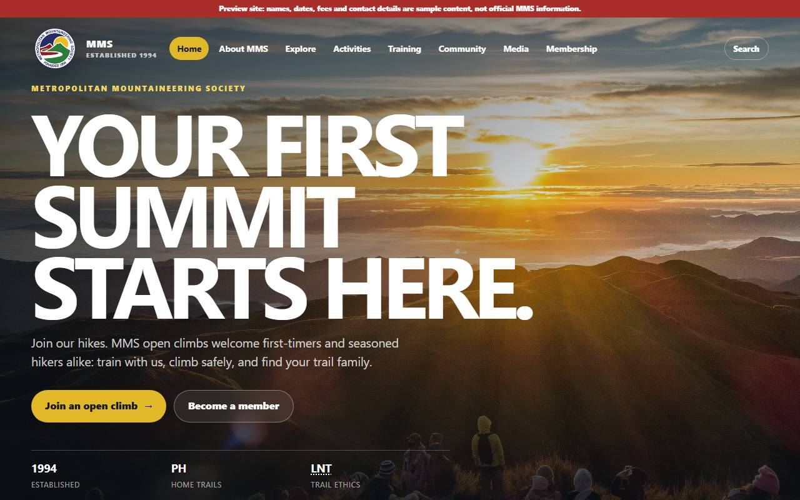
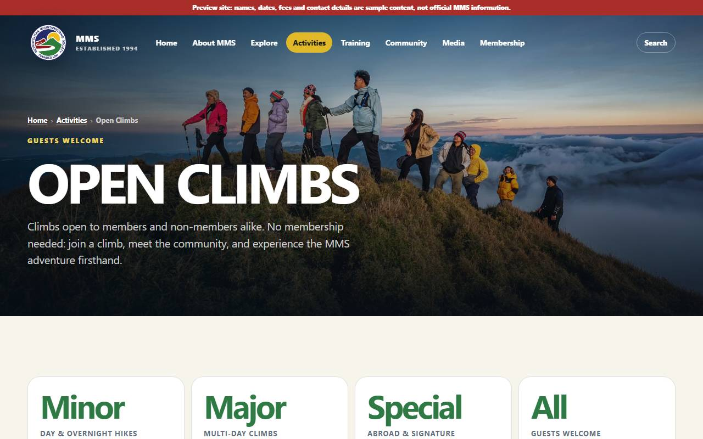
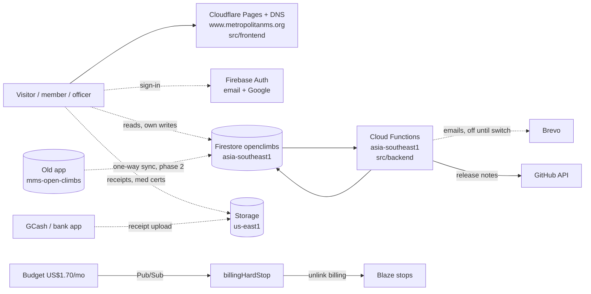
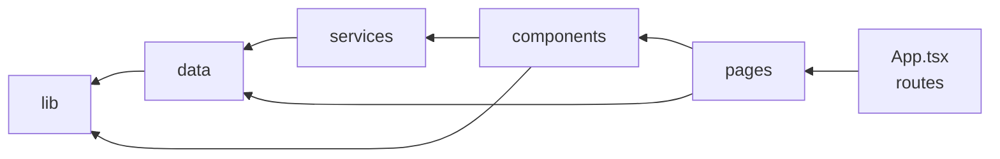
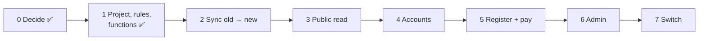
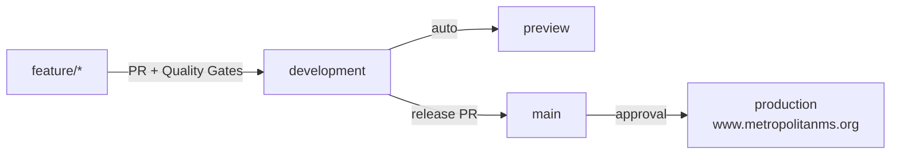

# MMS Official Site

Official website of the **Metropolitan Mountaineering Society (MMS)**: https://www.metropolitanms.org/

Replaces the old Google Sites page and is absorbing **Open Climbs** (climb registration, payments, member accounts, officer admin) from the separate app `mms-open-climbs.web.app`. Run by MMS at a hard cost cap of **₱54–₱100/month**.

Details live in [`docs/`](docs/GETTING-STARTED.md). This page is the map.

## Status (2026-11-08)

| Part | State |
|------|-------|
| Public site (info pages, climb finder, search) | **Live** on Cloudflare Pages |
| Firebase backend `mms-official-site-513809` | **Live, idle**: Auth (email + Google), Firestore `openclimbs`, Storage, security rules, 21 Open Climbs functions + billing hard stop. Emails off, no data yet |
| Open Climbs migration | Phase 1 of 7 done; next: sync users + data from the old app ([plan](docs/solution-plan/SOLUTION-PLAN.md#open-climbs-migration)) |
| Open items | [SOLUTION-PLAN → Open items](docs/solution-plan/SOLUTION-PLAN.md#open-items) (single tracker) |

## Screenshots

Live site, 2026-11-09 (sample content until officers confirm it). All pages: [USER-GUIDE](docs/guides/USER-GUIDE.md#whats-on-the-site).

| Home | Open Climbs | Phone |
|---|---|---|
|  |  |  |

## System

Solid = live. Dashed = planned.



| Part | Tech | Docs |
|------|------|------|
| Frontend | React 19, Vite 7, React Router 7, TypeScript strict; content in `src/frontend/data/*.ts` | [ARCHITECTURE](docs/guides/ARCHITECTURE.md), [DATA](docs/guides/DATA.md) |
| Backend | Firebase Blaze + hard stop: Auth, Firestore, Storage, Functions v2 (Node 22) | [API](docs/guides/API.md), [SECURITY](docs/guides/SECURITY.md) |
| Hosting, DNS, TLS | Cloudflare free (MMS account) | [DEPLOYMENT](docs/guides/DEPLOYMENT.md) |
| Costs | ≈ ₱54–92/month (domain + free tiers) | [BILLING](docs/guides/BILLING.md) |

## Frontend layers

Inner never imports outer (dependency-cruiser enforces).



## Open Climbs migration

Same users (copied with password hashes), same Firestore shapes, nobody re-registers. Old app stays until 2027. Why: [ADR 0005](docs/adr/0005-OPEN-CLIMBS-FIREBASE.md).



## Delivery



Every commit: pre-commit (gitleaks + eslint) → `npm run check` (~15 s: secrets, types, lint, layers, dead code, dupes, image budget, tests) → `/code-review` → `git commit -s`. Quality Gates adds audit, build + bundle budget, e2e, security-rules tests. Details: [CODE-QUALITY](docs/guides/CODE-QUALITY.md).

## Quick start

```sh
winget install --id Gitleaks.Gitleaks -e   # once (macOS: brew install gitleaks)
npm install                                # deps + git hooks
npm run dev                                # http://localhost:5173
npm run check                              # all blocking gates
npm run deploy:preview                     # check → build → perf → preview URL
npm run deploy:prod                        # … → production → prod parity
```

Backend: `cd src/backend && npx firebase-tools@15 deploy --only functions` ([DEPLOYMENT](docs/guides/DEPLOYMENT.md#backend-firebase)).

## Repo layout

```
src/frontend/   React SPA: lib/ data/ components/ pages/ App.tsx
src/backend/    firebase.json, firebase/ (rules, indexes), functions/ (own package.json)
tests/          unit/ component/ integration/ parity/ e2e/ performance/
scripts/        deploy.mjs, prod-parity.mjs     tools/  secrets.mjs, fetch-images.mjs
.config/        tool configs                    .githooks/ .github/  hooks, CI/CD
docs/           guides (what) · solution-plan (how) · adr (why)
```

## Docs

| Need | Read |
|------|------|
| Start here | [GETTING-STARTED](docs/GETTING-STARTED.md) |
| What it is | [OVERVIEW](docs/guides/OVERVIEW.md) · [ARCHITECTURE](docs/guides/ARCHITECTURE.md) · [DATA](docs/guides/DATA.md) · [API](docs/guides/API.md) |
| Officers | [USER-GUIDE](docs/guides/USER-GUIDE.md) |
| Developers | [DEVELOPER-GUIDE](docs/guides/DEVELOPER-GUIDE.md) · [CODE-QUALITY](docs/guides/CODE-QUALITY.md) · [TROUBLESHOOTING](docs/guides/TROUBLESHOOTING.md) |
| Run it | [DEPLOYMENT](docs/guides/DEPLOYMENT.md) · [BILLING](docs/guides/BILLING.md) · [SECURITY](docs/guides/SECURITY.md) |
| Plan + open items | [SOLUTION-PLAN](docs/solution-plan/SOLUTION-PLAN.md) |
| Gaps, roadmap, risks | [Gaps](docs/solution-plan/SOLUTION-PLAN.md#gaps-ui-vs-backend) · [Recommendations](docs/solution-plan/SOLUTION-PLAN.md#recommendations--enhancements) · [Risks](docs/solution-plan/SOLUTION-PLAN.md#risks--challenges) |
| Why | [ADRs](docs/adr/) |

Contributor rules (humans and Claude Code): [.claude/CLAUDE.md](.claude/CLAUDE.md).
