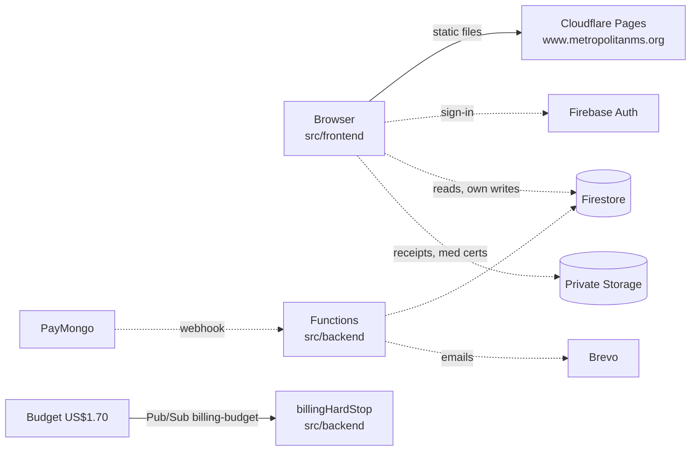
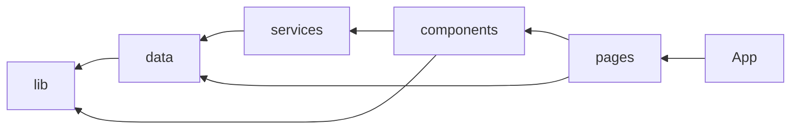

# Architecture

What runs where. Why: [ADR 0001](../adr/0001-HOSTING.md), [ADR 0005](../adr/0005-OPEN-CLIMBS-FIREBASE.md). Folder layout: [ADR 0006](../adr/0006-REPO-LAYOUT.md).

## System

Solid = live. Dashed = planned ([Open Climbs migration](../solution-plan/SOLUTION-PLAN.md#open-climbs-migration)).

| Part | Tech | Where |
|------|------|-------|
| Frontend | React 19, Vite 7, React Router 7, TypeScript strict | `src/frontend` → Cloudflare Pages (free) |
| Backend | Cloud Functions v2, Node 22, `asia-southeast1` | `src/backend` → Firebase `mms-official-site-513809` (Blaze + hard stop) |
| DNS, CDN, TLS | Cloudflare (MMS account) | root → `www` 301 |

## Frontend layers

Enforced by dependency-cruiser; inner never imports outer.

| Layer | Holds | Rule |
|-------|-------|------|
| `lib` | pure helpers (`asset`) | no React, no data |
| `data` | content + types ([DATA](DATA.md)) | no React |
| `services` | Firebase calls (phase 3+) | only Firebase importer |
| `components` | reusable UI; `ContentBlocks` renders all block types | no pages |
| `pages` | screens | — |
| `App.tsx` | routes, legacy redirects | — |

SPA routing: Pages serves `index.html` for unknown paths; `public/{assets,images}/404.html` keep missing files a real 404.

## Roles (planned)

| Role | Can |
|------|-----|
| Guest | read public data, create own registration |
| Member | + own profile, registrations |
| Climb officer | + participants/payments **of their climbs** |
| Admin | everything, assign roles |

Enforced in Firestore/Storage rules, never only UI. More: [SECURITY](SECURITY.md).
