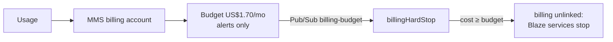

# Billing

What we pay and who owns it. Hard cap **₱54–₱100/month** ([ADR 0001](../adr/0001-HOSTING.md)). Checked 2026-11-05, ₱58 = US$1.

| Service | Provider / account | Cost/month |
|---------|--------------------|------------|
| Hosting, CDN, TLS, DNS | Cloudflare free (MMS) | ₱0 |
| Auth, DB, functions, storage | Firebase Blaze `mms-official-site-513809` | ≈ ₱0 (free quota) |
| Domain `metropolitanms.org` | Namecheap (MMS; push pending) | ₱92 (US$18.98/yr); Cloudflare Registrar ₱54 later |
| Payments | PayMongo (planned) | per payment only |
| Albums | MMS Google Drive | ₱0 |
| Officer email | Workspace for Nonprofits | ₱0 if approved |
| Code + CI/CD | GitHub, public repo | ₱0 |

**Total ≈ ₱54–92.** Anything that can pass ₱100 is out: paid plans, uncapped overage.

## Firebase hard stop

- Billing account must be **MMS-owned** (treasurer billing admin, ≥ 2 officers). Interim: Owee's account, same budget + hard stop wired ([open item 1](../solution-plan/SOLUTION-PLAN.md#open-items)).
- Budget scoped to the project. Native GCP spend caps cover only some services; the function is the real stop.
- Alerts alone don't stop spend. Treasurer checks the bill monthly.

## Per-payment fees (PayMongo, +12% VAT on fee)

On ₱3,000: QR Ph 1.34% **₱45** · online banking 0.71%/₱13.39 ₱24 · Maya 1.79% ₱60 · GCash 2.23% ₱75 · card 3.125% + ₱13.39 ₱120 · manual receipt ₱0. Payouts → MMS bank account.

## Stay in free quota

WebP + image budget · cache headers (`public/_headers`) · no SMS login · albums on Drive, not in repo.

Sources: [Firebase](https://firebase.google.com/pricing) · [Cloudflare Pages limits](https://developers.cloudflare.com/pages/platform/limits/) · [PayMongo](https://www.paymongo.com/pricing) · [Namecheap .org](https://www.namecheap.com/domains/registration/gtld/org/) · [Workspace for Nonprofits](https://support.google.com/nonprofits/answer/2858465).
