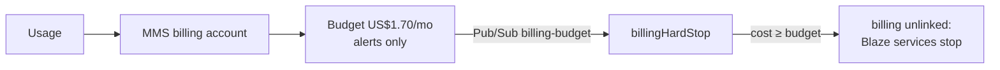

# Billing

> - **Purpose:** What the site costs and who pays.
> - **For:** Owner (accounts, billing) · Officers and leads · Developers
> - **In short:** The site is built to cost ₱54–₱100 a month, mostly the domain. Every service is on a free plan; Firebase has an automatic hard stop that switches billing off before charges pass about US$1.70.

What we pay and who owns it. Hard cap **₱54–₱100/month** ([ADR 0001](../adr/0001-HOSTING.md)). Checked 2026-11-05, ₱58 = US$1.

| Service | Provider / account | Cost/month |
|---------|--------------------|------------|
| Hosting, CDN, TLS, DNS | Cloudflare free (MMS) | ₱0 |
| Auth, DB, functions, storage | Firebase Blaze `mms-official-site-513809` | ≈ ₱0 (free quota) |
| App Check (reCAPTCHA Enterprise / Fraud Defense) | same project | ₱0 up to 10k checks/month; next tier US$8 would trip the hard stop (sign-in/admin only, token 1 day) |
| Domain `metropolitanms.org` | Namecheap (MMS; push pending) | ₱92 (US$18.98/yr); Cloudflare Registrar ₱54 later |
| Payments | GCash / QR Ph transfer to MMS account, receipt upload ([ADR 0007](../adr/0007-PAYMENTS-MANUAL.md)) | ₱0 |
| Albums | MMS Google Drive | ₱0 |
| Officer email | Workspace for Nonprofits | ₱0 if approved |
| Code + CI/CD | GitHub, public repo | ₱0 |

**Total ≈ ₱54–92.** Anything that can pass ₱100 is out: paid plans, uncapped overage.

## Firebase hard stop

- Billing account must be **MMS-owned** (treasurer billing admin, ≥ 2 officers). Interim: Owee's account, same budget + hard stop wired ([open item 1](../solution-plan/SOLUTION-PLAN.md#open-items)).
- Budget scoped to the project. Native GCP spend caps cover only some services; the function is the real stop.
- Alerts alone don't stop spend. Treasurer checks the bill monthly.

## Payments

No gateway ([ADR 0007](../adr/0007-PAYMENTS-MANUAL.md)): participants transfer to the MMS account by QR, upload the receipt, officers verify. ₱0 to MMS; any transfer fee is the sender's bank/wallet fee. PayMongo (ADR 0002, superseded) would have cost 1.34% + VAT per QR Ph payment (≈ ₱45 on ₱3,000).

## Stay in free quota

WebP + image budget · cache headers (`public/_headers`) · no SMS login · albums on Drive, not in repo.

**Public Firestore reads** (item 22): billed per document returned, free 50k/day (first database only, `openclimbs`). Each page reads only what it shows, once per page load: home ≈ 4 (settings + 3 announcements), news ≤ 31, surveys ≤ 51, Our story ≤ 51, Leadership ≤ 301 (every officer term). An empty query or missing doc still counts 1. ≈ 160+ full Leadership loads or 12,000 home loads a day before any charge (then ≈ US$0.03 per 100k reads, under the US$1.70 hard stop).

Sources: [Firebase](https://firebase.google.com/pricing) · [Cloudflare Pages limits](https://developers.cloudflare.com/pages/platform/limits/) · [PayMongo](https://www.paymongo.com/pricing) · [Namecheap .org](https://www.namecheap.com/domains/registration/gtld/org/) · [Workspace for Nonprofits](https://support.google.com/nonprofits/answer/2858465).
