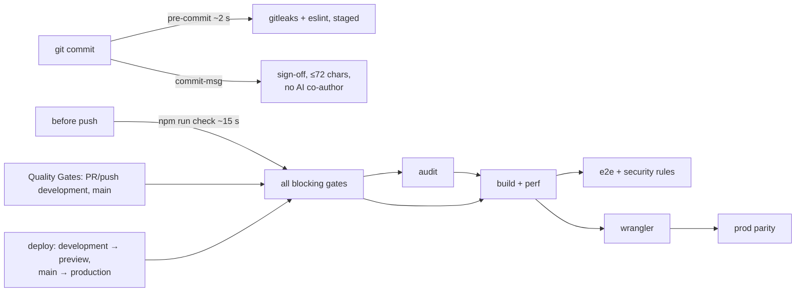

# Code quality

**Minimum viable harness:** one hook (~2 s), one command (`npm run check`, ~15 s), Quality Gates repeats it. No step unless it catches something real. Why these tools: [ADR 0003](../adr/0003-QUALITY-HARNESS.md).

## Gates

| Priority | Concern | Tool | Config | Blocks |
|----------|---------|------|--------|--------|
| High | Secrets | gitleaks (`tools/secrets.mjs`) | `.config/gitleaks.toml` | ✅ hook, check, Quality Gates |
| High | Bad patterns, dead logic | eslint + sonarjs | `eslint.config.js` | ✅ |
| High | Banned API / forbidden imports | eslint | `eslint.config.js` | ✅ |
| High | Cyclomatic ≤ 12, cognitive ≤ 15 | eslint | `eslint.config.js` | ✅ |
| High | Cycles, layers, orphans, dev deps in src | dependency-cruiser | `.config/dependency-cruiser.cjs` | ✅ |
| High | Dead code, exports, types (models), deps | knip | `.config/knip.json` | ✅ |
| High | Duplication > 3% | jscpd | `.config/jscpd.json` | ✅ |
| High | Vulnerable packages (high+), site + backend | `npm audit` | — | ✅ Quality Gates |
| High | Build guards: types, bundle + image budgets, prod parity | tsc, `tests/performance`, `scripts/prod-parity.mjs` | — | ✅ build/deploy |
| High | Reuse, SOLID, long comments | `/code-review` | `.claude/CLAUDE.md` | review |
| Low | Style, naming, `no-console` | eslint | — | warn |
| Low | Formatting | `.editorconfig` | — | editor |

Generated `src/frontend/data/{credits,topMountains}.ts`: excluded from lint + dupes.

## Tests

| Kind | Folder | Tool | Covers |
|------|--------|------|--------|
| Unit | `tests/unit` | vitest | sitemap, data invariants, helpers, backend budget logic; `tests/unit/functions` = Open Climbs functions (node env, mocked Firebase) |
| Component | `tests/component` | vitest + Testing Library | ContentBlocks, Gallery, Nav |
| Integration | `tests/integration` | vitest + Testing Library | every route, redirects, page flows |
| Security rules | `tests/integration/rules.emulator.mjs` | Firebase emulators (Java), `npm run test:rules` | Firestore + Storage rules: money, roster, private files; Quality Gates only |
| Parity | `tests/parity`, `scripts/prod-parity.mjs` | vitest todos, node | Open Climbs feature gaps; live = local build |
| E2E | `tests/e2e` | Playwright (Chromium) | smoke on the real build |
| Performance | `tests/performance` | node | JS ≤ 120 KB gz, CSS ≤ 20 KB gz, images ≤ 1.2 MB / 15 MB |

Lowest level that catches the bug. E2E stays a short smoke suite.

## AI agent harness

No AI agents in the product. Claude Code (dev) bound by `.claude/CLAUDE.md` (rules + done gate), `.claude/settings.json` (denies `--no-verify`, force push), `commit-msg` hook.

## Not included (on purpose)

Prettier (churn; `.editorconfig` enough) · coverage thresholds (reward line-counting) · spellcheckers · Husky (plain `.githooks/`) · e2e in `check` (slow; Quality Gates + UI changes). Harness > ~30 s → move steps to Quality Gates, don't add tools.
