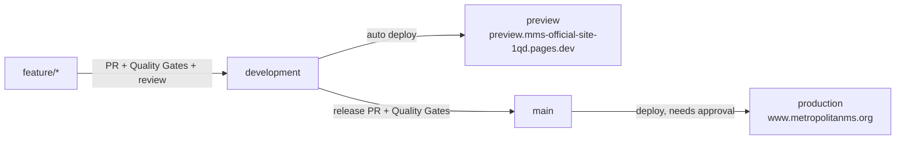

# Deployment

> - **Purpose:** How changes reach the live site, and how the services are set up.
> - **For:** Developers · Owner (accounts, billing)
> - **In short:** Every change goes to a preview site first, then to www.metropolitanms.org after the owner approves. Also covers the domain, accounts and Firebase setup.

**Production: https://www.metropolitanms.org/** on Cloudflare Pages (free), project `mms-official-site` in the MMS Cloudflare account. Live since 2026-11-05. Why: [ADR 0001](../adr/0001-HOSTING.md).

## Deploy (Wrangler CLI)

```sh
npx wrangler login        # once; wrangler is a pinned devDependency
npm run deploy:preview    # check → build → perf → https://preview.mms-official-site-1qd.pages.dev
npm run deploy:prod       # check → build → perf → production → prod parity
```

- No Cloudflare Git integration: deploys run from `scripts/deploy.mjs`, locally or via GitHub Actions ([branches](#branches--environments)).
- Pages URL: `https://mms-official-site-1qd.pages.dev` (`-1qd` suffix: the plain name was taken).
- No top-level `404.html` → Pages serves `index.html` for deep links (SPA). `public/{assets,images}/404.html` make missing files there a real 404, not cached HTML.
- Headers/cache: `public/_headers` (security headers, CSP report-only, `/assets` 1 yr immutable, `/images` 1 week).
- Guards (`scripts/deploy.mjs`): check → build → bundle budget → deploy → prod parity (`main`).
- CI/CD per branch: [below](#branches--environments).
- New account only: create the project once with `npx wrangler pages project create mms-official-site --production-branch main --force`. `--force` keeps it on classic Pages; without it wrangler delegates to Workers, rewrites `vite.config.ts`/`package.json`, adds `wrangler.jsonc`, and (4.151–4.157) crashes. Never pass `--force` again after. New `*.pages.dev` hostnames take a few minutes to get TLS.

## Branches & environments



| Branch | Gets | Quality Gates | CD |
|--------|------|----|----|
| `feature/*`, `fix/*` | daily work | on PR | — |
| `development` | integrated, tested work | PR + push | auto → preview |
| `main` | released code only (PR from `development`) | PR + push | → production after `production` environment approval, then prod parity |

Data per environment:

| Where | Firebase | Writes |
|---|---|---|
| local dev, CI tests | emulators (`VITE_USE_EMULATORS=true`), or none | test data only |
| preview | prod project | **off**: `deploy.mjs` builds with `VITE_WRITES_ENABLED=false`; `/admin` shows read-only, saves refused |
| production | prod project | on (admins) |

Never test data in prod. Rules still guard writes; the flag stops honest mistakes on preview.

AI in the loop (₱0): Claude Code `/code-review` + done gate before every commit (`.claude/CLAUDE.md`); PR template repeats the gate. No paid AI review in Quality Gates (cost cap).

GitHub setup (repo settings, owner): protect `development` + `main` (PR required; `Code Quality & Security`, `End-to-End Tests`, `Security Rules Tests` required; no force push); environment `production` with required reviewer; secrets `CLOUDFLARE_API_TOKEN`, `CLOUDFLARE_ACCOUNT_ID`. **Until those secrets exist, CD passes but skips the deploy** (Release Guard warning): after merging to `main`, run `npm run deploy:prod` locally ([open item 5](../solution-plan/SOLUTION-PLAN.md#open-items)).

## Backend (Firebase)

Project `mms-official-site-513809`. Run from `src/backend` (`firebase.json` there). Not in CD: deploy by hand after the PR merges.

```sh
cd src/backend
npx firebase-tools@15 deploy --only firestore,storage   # rules + indexes (src/backend/firebase)
npx firebase-tools@15 deploy --only functions           # all functions (after firestore: new queries need their indexes built first)
npx firebase-tools@15 deploy --only functions:<name>    # one function
```

| Resource | Setting |
|----------|---------|
| Firestore | named DB `openclimbs`, `asia-southeast1` |
| Storage | default bucket, `us-east1` (only no-cost locations are US; fixed once created) |
| Auth | email/password + Google (public name "Metropolitan Mountaineering Society", support email Owee's Gmail until MMS Gmail is a project member); authorized domains `www.metropolitanms.org`, `preview.mms-official-site-1qd.pages.dev` |
| Functions | `asia-southeast1`, max 5 instances, 256 MiB (`shared/admin.js`) |
| Secrets | `BREVO_API_KEY`, `BREVO_FROM_EMAIL` (placeholders until Brevo, open item 8), `GITHUB_TOKEN` (fine-grained, Contents read-only on this repo) |

### Firebase web key + App Check

- **Repo Variables** (not secrets; public web config) feed CD builds: `VITE_FIREBASE_API_KEY`, `VITE_FIREBASE_AUTH_DOMAIN`, `VITE_FIREBASE_PROJECT_ID`, `VITE_FIREBASE_APP_ID`, `VITE_APP_CHECK_SITE_KEY`. Missing → site shows sample content, sign-in "not set up".
- **Web API key** ("Browser key (auto created by Firebase)", Google Cloud → Credentials): Firebase's API list + website referrers `https://www.metropolitanms.org/*`, `https://metropolitanms.org/*`, `https://mms-official-site-1qd.pages.dev/*`, `https://*.mms-official-site-1qd.pages.dev/*`, `https://mms-official-site-513809.firebaseapp.com/*`, `http://localhost:5173/*`, `http://localhost:4173/*`. Auth enforces it; Firestore ignores key restrictions (rules guard data).
- **App Check**: reCAPTCHA Enterprise key "MMS site App Check (web)" (Google Cloud → Fraud Defense; domains `metropolitanms.org`, `mms-official-site-1qd.pages.dev`, `localhost`, subdomains included), registered for the web app, token TTL 1 day, **monitor mode** (APIs not enforced). Client: `services/firebase.ts` (sign-in/admin only).
- **New host** (custom domain, new Pages project): add it to Auth authorized domains, the key's referrers, and the reCAPTCHA key's domains, or sign-in breaks there.

Set a secret in **your own terminal** (it prompts; never paste the value into a command or chat): `npx firebase-tools@15 functions:secrets:set NAME --project mms-official-site-513809`, then redeploy the functions that use it.

## Accounts

- Cloudflare owner: **MMS shared Gmail** (officers know the address). 2-step verification on Gmail + Cloudflare; recovery known to ≥2 officers.
- **2 owners:** MMS account + Owee Penaranda as **Super Administrator** (Manage Account → Members, own login). Other officers: Administrator. Never share the password.
- MMS Gmail is held by another officer: every MMS-owned account also has Owee as a second owner/admin (Cloudflare Super Administrator, Firebase IAM Owner).
- **Rule for new accounts:** MMS Gmail = primary owner (creates it, holds billing), Owee = second owner. Firebase `mms-official-site-513809` is the exception (created by Owee, 2026-11): move its Blaze billing to an MMS billing account once the Gmail owner is available.
- Wrangler logged in as a member sees several accounts → set `CLOUDFLARE_ACCOUNT_ID` to the MMS account ID before deploying.
- Open check ([ADR 0001](../adr/0001-HOSTING.md)): `dash.cloudflare.com` not blocked on company laptops.

## Domain `metropolitanms.org`

- **MMS owns the domain.** Registered 2023-01-05 at Namecheap; expires **2027-01-05**, auto-renew **off**. 2026-11-05: Namecheap "Change Ownership" push from the personal account to the MMS Namecheap account; MMS must accept it, then turn auto-renew on (renewal US$18.98/yr). Registrant contacts → MMS: **after** the Cloudflare transfer below if that's planned (a registrant change locks transfers 60 days), otherwise any time.
- DNS: zone in the MMS Cloudflare account (Free), nameservers `magnolia` / `syeef`.ns.cloudflare.com. Root + `www` = proxied CNAME → `mms-official-site-1qd.pages.dev`; both attached as Pages custom domains. No MX: no email on the domain.
- Canonical host: `www`.

Later (optional, renewal US$11.20/yr): registrar transfer Namecheap → Cloudflare (MMS), in this order:

1. Namecheap → Domain → Sharing & Transfer → Domain Lock **off** → get the EPP/auth code (emailed to the registrant). **Don't edit registrant contacts first.**
2. Cloudflare (MMS) → Domains → Transfers → `metropolitanms.org` → auth code → pay (adds 1 year) → registrant contact = MMS.
3. Approve Namecheap's transfer email (or it completes in ~5 days).
4. Cloudflare: auto-renew **on**. Close the Namecheap listing.

## Budget

Costs, hard cap, Firebase hard stop: [BILLING](BILLING.md).
