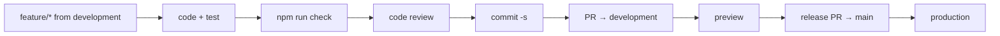

# Developer guide

> - **Purpose:** Day-to-day work on the code.
> - **For:** Developers
> - **In short:** Commands, folder layout, coding rules and the checks and reviews every change goes through.

Setup: [GETTING-STARTED](../GETTING-STARTED.md). Claude Code rules: `.claude/CLAUDE.md` (humans follow the same).

## Commands

| Command | What |
|---------|------|
| `npm run dev` | dev server, http://localhost:5173 |
| `npm run check` | all blocking gates (~15 s); before every push |
| `npm test` | unit, component, integration, parity (vitest) |
| `npm run test:e2e` | Playwright smoke (`npx playwright install chromium` once) |
| `npm run build && npm run test:perf` | build + bundle budget |
| `npm run test:parity` | live site serves local `dist/` |
| `npm run check:audit` | high+ vulnerabilities (site + backend) |
| `npm run test:rules` | Firestore + Storage rules on emulators (needs Java) |
| `npm run deploy:preview` / `deploy:prod` | [DEPLOYMENT](DEPLOYMENT.md) |
| `cd src/backend && npx firebase-tools@15 deploy --only …` | backend ([DEPLOYMENT](DEPLOYMENT.md#backend-firebase)) |

## Workflow

1. Branch `feature/<name>` from `development` ([branches](DEPLOYMENT.md#branches--environments)). Reuse `src/frontend/components` (esp. `ContentBlocks`) before new UI.
2. Test at the lowest level that catches the bug ([CODE-QUALITY](CODE-QUALITY.md#tests)).
3. `npm run check` green; UI change → `test:e2e`.
4. `/code-review` in Claude Code; fix confirmed findings.
5. Update docs + [open items](../solution-plan/SOLUTION-PLAN.md#open-items) in the same change.
6. `git commit -s -m "Short imperative subject"` (hook: sign-off, ≤ 72 chars, no AI co-author).
7. PR → `development` (Quality Gates + template checklist). Release: PR `development` → `main`.

## Editing content

- Subpages: `src/frontend/data/subpages.ts`. Program pages: `pages.ts`. Home: `content.ts`.
- New subpage: add to `sitemap.ts`, then its blocks to `subpages.ts`.
- Photos: add to `data/images.json` → `node tools/fetch-images.mjs`. Albums: Drive links ([media](../solution-plan/SOLUTION-PLAN.md#media)).
- Real data only from MMS. All confirmed → `previewNotice = ''`.
- UI changed → `node tools/screenshots.mjs` (live site; pass a URL for preview/local) to refresh `docs/images/screenshots` used by README + USER-GUIDE.

## Sign-in + admin (local)

1. `cp .env.example .env.local`, fill `VITE_FIREBASE_API_KEY` from `cd src/backend && npx firebase-tools@15 apps:sdkconfig WEB` (keep `# gitleaks:allow` on that line). Optional `VITE_APP_CHECK_SITE_KEY` (public; [DEPLOYMENT](DEPLOYMENT.md#firebase-web-key--app-check), same `# gitleaks:allow`). Only `localhost:5173` / `4173` are allowed referrers for the web key.
2. Safe testing: `VITE_USE_EMULATORS=true` + `cd src/backend && npx firebase-tools@15 emulators:start --only auth,firestore` (Java). Prod: `false`.
3. Emulator data: `SEED_PASSWORD=<pick one> node tools/admin/seed-emulator.mjs` (sample admin + member sign-ins, 2 sample climbs).
4. `npm run dev` → `/account/sign-in`. First sign-in creates `users/{uid}` as `member`.
5. Make an admin (real project, owner, after `gcloud auth application-default login`): `node tools/admin/set-admin.mjs <uid|email>` (rules block self-promotion). Then `/admin`. Never commit uids.

Owner-only scripts (`tools/admin`, firebase-admin from `src/backend/functions`; project from `.env.local` or `--project <id>`):

| Script | Does |
|---|---|
| `set-admin.mjs <uid\|email>` | first admin / break-glass; existing profile: role only |
| `grant-email-members.mjs <uid\|email> [--revoke]` | `canEmailMembers` (rules refuse it from every client) |
| `purge-admin-pageviews.mjs` | one-off: drop page views logged on `/admin` + `/account` before the client skipped them |
| `copy-old-data.mjs [--apply] [--overwrite] [--only a,b] [--hash-params file]` | everything from the old project: sign-in accounts (Google link kept; passwords only with `--hash-params`) + all 11 other collections, same ids. Dry run by default. Set `GOOGLE_CLOUD_QUOTA_PROJECT=<this project>` for Auth calls. Re-copy climbs with `copy-old-climbs.mjs --overwrite` afterwards: registration triggers bump the counts |
| `swap-account.mjs [--apply]` | one-off after the copy: an account here that shares an email with a different-id old account is replaced by the old one (role and registrations belong to it). Deletes the new account; dry run by default. The admin claim is only set when the role changes, so set it once for a swapped admin |
| `copy-old-storage.mjs [--apply] [--rewrite]` | copies the old project's Storage files (receipts, certificates, permits, QR images) into this bucket, same paths and tokens; `--rewrite` repoints the links stored in records. Dry run by default |
| `seed-emulator.mjs` | emulator only |
| `copy-old-climbs.mjs [--from mms-open-climbs] [--apply] [--overwrite]` | copies the old app's `climbs` here with the same ids; dry run by default, existing climbs kept unless `--overwrite`. Needs your Google login on both projects. Interim until the scheduled sync (plan item 7); registrations are not copied |

Old backfills (`backfill-climb-denorm`, `backfill-member-details`) not ported: synced data already carries those fields; port only if a gap shows up.

Firebase code lives only in `src/frontend/services/` and loads on `/account/*` + `/admin` only (bundle budget: `initialJs` total vs `largestLazyJs` per on-demand file).

## Design sessions

`/grill-with-docs` (Claude Code, `.claude/skills/`): one-question-at-a-time interview on a plan or design; resolved terms go to the domain glossary `docs/guides/CONTEXT.md`, hard-to-reverse decisions to `docs/adr/`. `/grilling` alone = interview without docs.

## Backend changes

- Functions: `src/backend/functions/src` (ESM). Tests: `tests/unit/functions` (vitest, node env, mocked Firebase). Root `npm run check` covers them.
- Rules: `src/backend/firebase/*.rules` → `npm run test:rules` locally, or let Quality Gates run **Security Rules Tests**.
- New dependency: `npm i --prefix src/backend/functions -E <pkg>`.
- Deploy after merge ([DEPLOYMENT](DEPLOYMENT.md#backend-firebase)). Emails stay off until the switch (`EMAILS_ENABLED`).

## Code style

- Small single-purpose units (SOLID); data apart from UI; no god files.
- Comments ≤ 2 lines, why not what. No commented-out code.
- PascalCase types/components, camelCase values (eslint warns).
