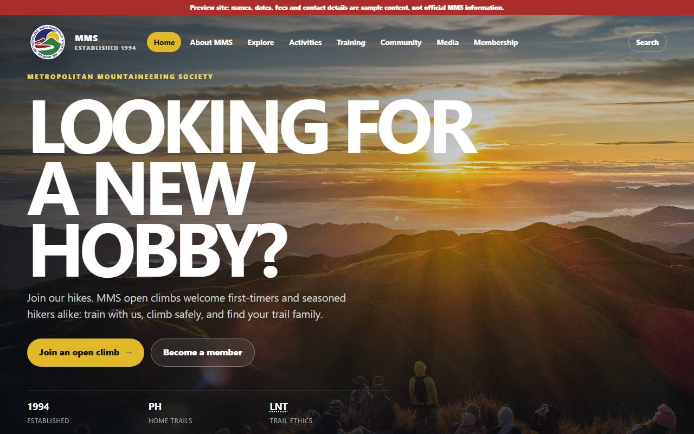
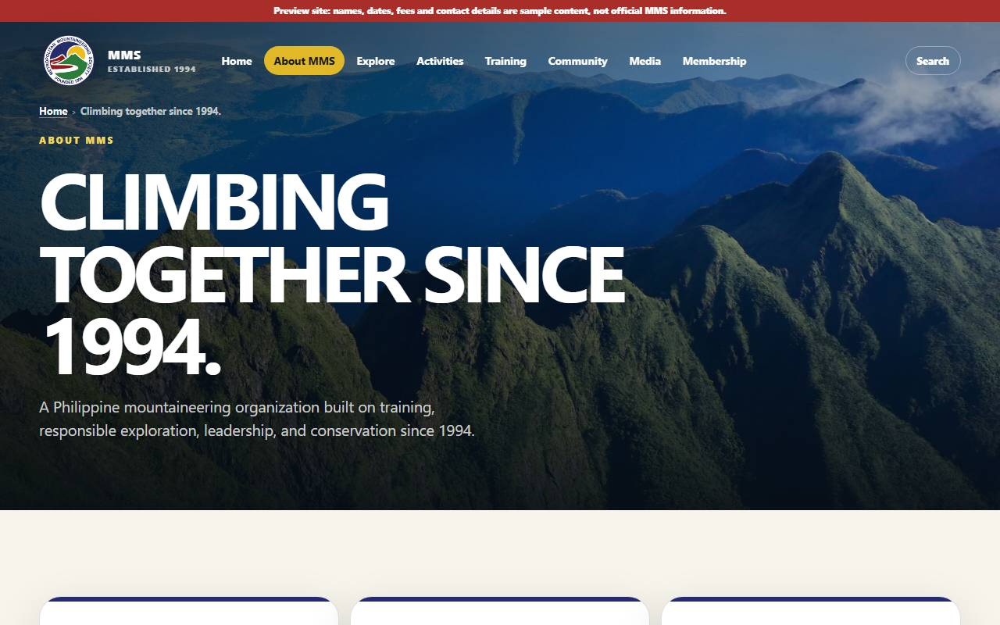
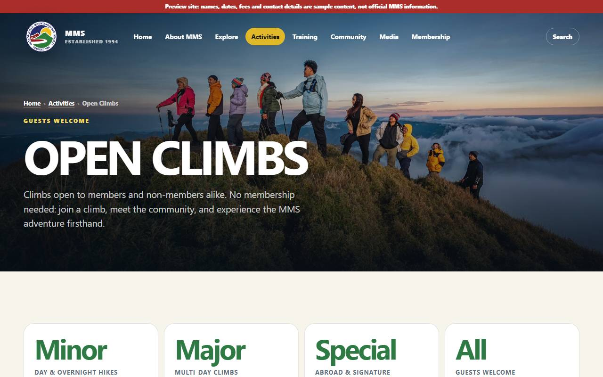
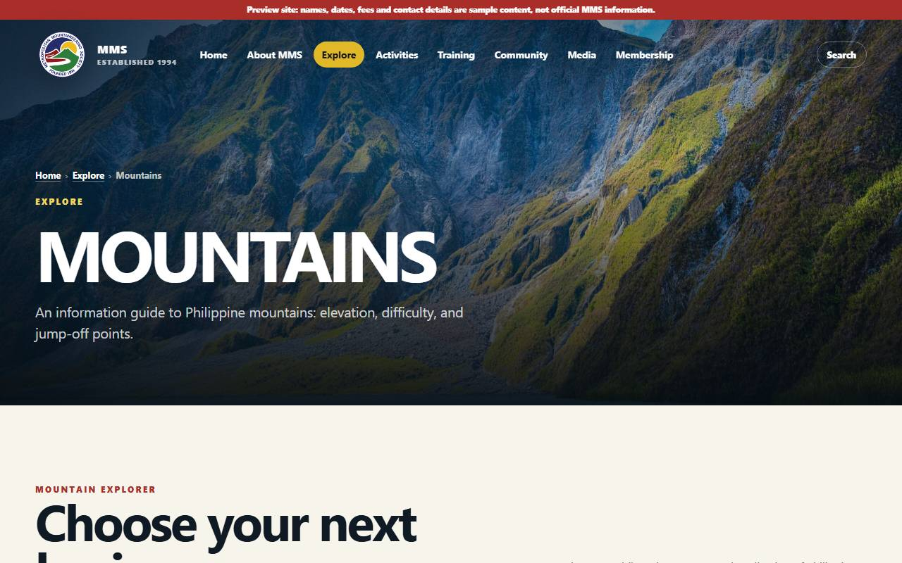
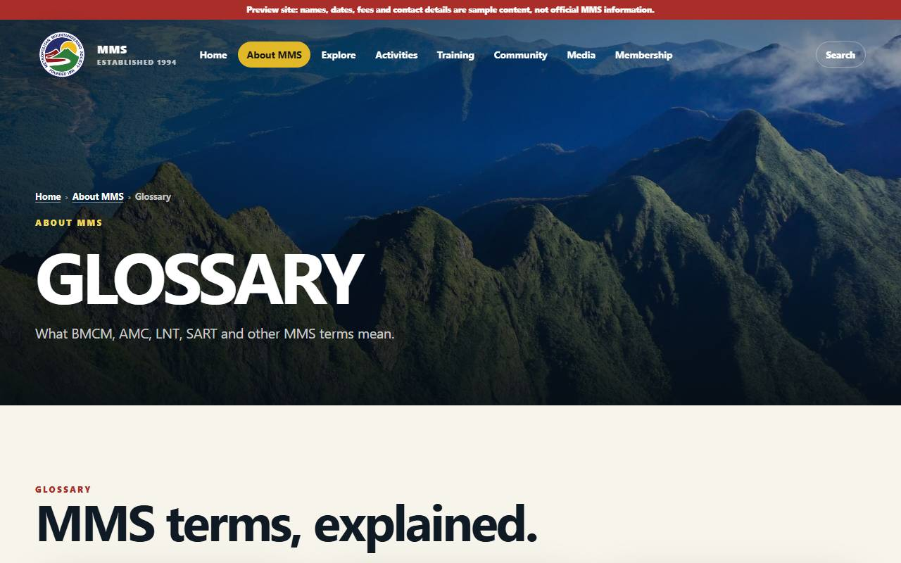
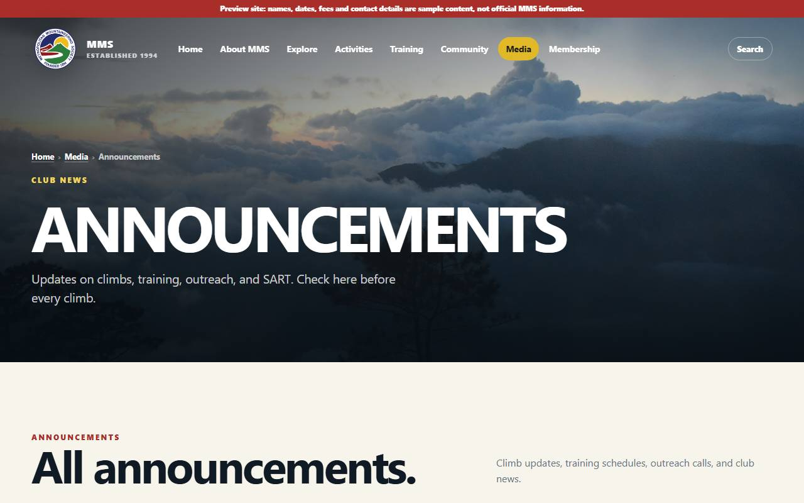
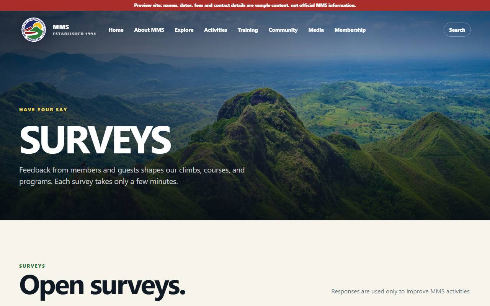
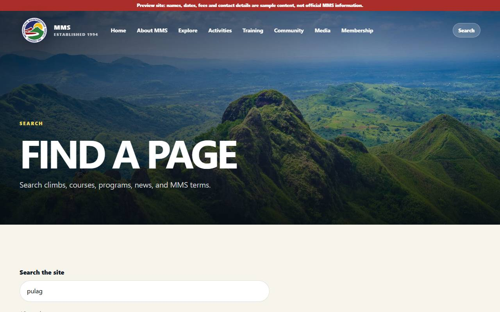
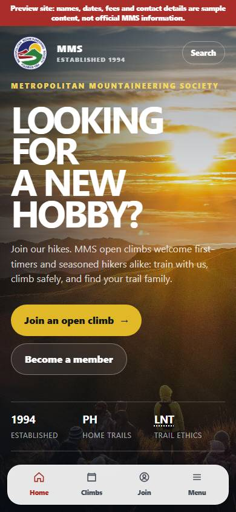
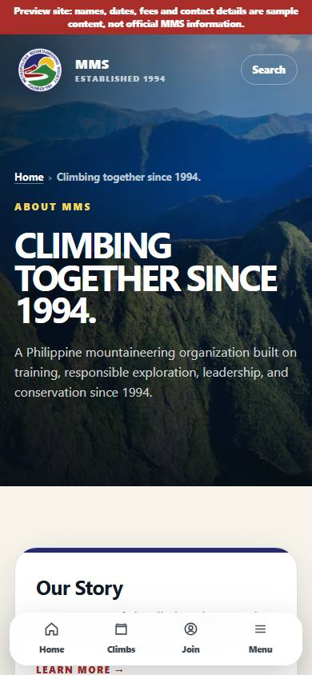

# User guide

> - **Purpose:** What the site offers and how to get content changed.
> - **For:** Officers and leads · Members and guests · Site admins
> - **In short:** How to find things on the site, how admins update announcements, officers and other content in `/admin`, and how to ask for anything else to change.

Developers: [DEVELOPER-GUIDE](DEVELOPER-GUIDE.md).

## What's on the site

| Section | Has |
|---------|-----|
| Home | short summary: hero, each section's top 3 pages + "See all", upcoming climbs, news, how to join |
| Section pages (`/about`, `/explore`, …) | every page in that section |
| About · Explore · Activities · Training · Community · Media | subpages (history, mountains Top 100, BMC, Outreach, SART, albums, videos, surveys, glossary…) |
| Banner | "Preview site": content is sample until officers confirm it |

### Screenshots

Live site, 2026-11-09. Refresh: `node tools/screenshots.mjs` ([DEVELOPER-GUIDE](DEVELOPER-GUIDE.md#editing-content)).

| Page | Desktop |
|---|---|
| Home (`/`) |  |
| Section, e.g. About (`/about`) |  |
| Open Climbs + climb finder (`/activities/open-climbs`) |  |
| Mountains, Top 100 (`/explore/mountains`) |  |
| Glossary (`/about/glossary`) |  |
| News (`/media/news`) |  |
| Surveys (`/surveys`) |  |
| Search (`/search?q=pulag`) |  |

| Phone: home | Phone: About |
|---|---|
|  |  |

Old Google Sites links redirect to the matching new page. **Search** (top right) finds any page, climb, news item, or MMS term.

## Getting content changed

1. Send the change to the site maintainer (Owee) with the **source** (officer list, fee memo, approved announcement).
2. Maintainer edits, checks, deploys. Live in minutes.
3. Never send passwords or IDs by chat/email.

Waiting on officers: [content needed](../solution-plan/SOLUTION-PLAN.md#content-needed-from-mms). When everything is confirmed, the preview banner comes off.

## Photo albums

Upload to the MMS Google Drive `Albums/YYYY-MM climb` folder, remove photos of anyone who opted out, share as "anyone with link, Viewer", send the folder link. Details: [SOLUTION-PLAN media](../solution-plan/SOLUTION-PLAN.md#media).

## Open Climbs

The schedule on `/activities/open-climbs` lists upcoming climbs, climbs completed this year, and any past year (**Past years** picker). Each live climb has its own page, `/climbs/<id>`: dates, stats, photos (tap for full screen), weather forecast from 16 days before (plus PAGASA / Windy links), trail maps (AllTrails, Komoot or Google Maps; tabs for alternate routes), water-source note, day-by-day itinerary, packing list, Leave No Trace, and **Share this climb** (phone: Share… for Messenger, Viber and others, plus Instagram story; any device: Facebook, Copy link). Climbs come from the Open Climbs database; until officers load them the schedule shows samples.

**Adding or editing a climb (admins):** sign in, open `/admin` → **Climbs** (newest first, labelled date · name · status). Start as **draft** (hidden), fill name, location, type, start date and what you know (difficulty as N/9, trail class 1–6, distances, packing list one item per line, photo links one per line, map links), then set **open**. Mark **completed** after the climb, **cancelled** if called off (hidden from lists, its link explains), or pick **postponed**. Past years: enter them the same way with their real dates. Lists (**Fees**, **Climb officers**, **Itinerary**, **Trail routes**) are small tables: **Add row**, ↑ to reorder, **Remove**. Fees: amount in pesos or TBA; tick **Optional** for extras (transport, meals) and **Guest fee** for the fee only guests pay. Itinerary: one row per activity; rows with the same day name in a row form that day. Changes show on the public pages right away. Payment QR and required documents come with registration. Edit on www.metropolitanms.org: the preview site is read-only.

### Coming

Registration, payments, and My Climbs move here from `mms-open-climbs.web.app` (same login). Until the switch, register on the old site. Plan: [Open Climbs migration](../solution-plan/SOLUTION-PLAN.md#open-climbs-migration).

## Accounts officers hold

MMS Gmail (primary owner of Cloudflare, Firebase, Namecheap, Drive). 2-step verification on; recovery known to ≥ 2 officers; hand over at turnover ([SECURITY](SECURITY.md#accounts)).
