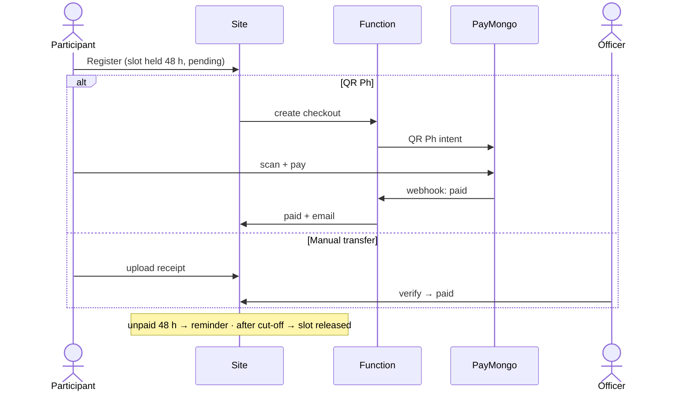

# Solution plan

How we deliver the MMS site and what it must do. Why: [ADRs](../adr/). What it is / how to run: [guides](../guides/).

**Contents:** [Goal](#goal) · [Open items](#open-items) · [Leads input](#leads-input-2026-11-05) · [Features](#features) · [Architecture](#architecture) · [Open Climbs migration](#open-climbs-migration) · [Payments](#payments) · [Media](#media) · [Hosting & billing](#hosting--billing) · [Quality harness](#quality-harness) · [Content needed](#content-needed-from-mms)

## Goal

Replace metropolitanms.org (Google Sites) with a site MMS runs itself, **₱54–₱100/month hard cap** ([ADR 0001](../adr/0001-HOSTING.md)): public info pages (live), Open Climbs registration + payments + tracking (officers stop chasing balances), member accounts, officer admin.

## Open items

Single tracker. Claude reads this before every commit and updates it in the same change.

| # | Item | Owner | Blocks |
|---|------|-------|--------|
| 1 | ~~MMS Google Cloud billing account; move `mms-official-site-513809` to it; US$1.70 alerts-only budget → Pub/Sub `billing-budget`~~ (done 2026-11-06) | MMS Gmail owner, Owee | — |
| 2 | Grant **Project Billing Manager** to `729371585953-compute@developer.gserviceaccount.com` (hard stop can't unlink billing without it) | Owee | Phase 1 |
| 3 | ~~Merge PR #2, release v1.0.0~~ (done 2026-11-05) | Owee | — |
| 4 | Accept Namecheap push (MMS account), auto-renew on (expires 2027-01-05); add Owee as Cloudflare Super Administrator | MMS Gmail owner | Domain safety |
| 5 | Cloudflare API token (Pages:Edit) + account id → repo secrets for `continuous-delivery.yml` | MMS Cloudflare owner | Quality Gates deploy (local deploy works) |
| 6 | Firebase console/CLI reachable from company laptops | Owee | Phase 1 |
| 7 | Old project's password hash parameters (private, never in repo/chat) | Owee | Phase 2 |
| 8 | Brevo account owned by MMS; SPF/DKIM for `metropolitanms.org` | MMS | Phase 4 |
| 9 | `npm audit`: 11 moderate (minimatch via eslint 10, undici via wrangler deps); below the high gate. High undici fixed by wrangler 4.158.0 (2026-11-05) | upstream | — |
| 10 | Open Climbs feature parity: 25 `it.todo` in `tests/parity/open-climbs.test.ts` | dev | Switch |
| 11 | Content from MMS ([below](#content-needed-from-mms)); then set `previewNotice = ''` | officers | Remove preview banner |
| 12 | ~~SDLC setup~~ (done 2026-11-05): `development` default branch; `development` + `main` protected (PR, Quality Gates required, no force push, admins included); `production` environment needs Owee approval, protected branches only | Owee | — |
| 13 | Leads: who is TCOM + notification recipients (by role); official FB page URL; is Viber a must (likely paid)? | leads | L2 |
| 14 | Leads: real active-member count + recent climb photos with consent; ITI + expected expenses per upcoming climb; who approves reviews | leads, climb officers | L4, L5, L6 |
| 15 | Officers confirm glossary wording (`src/frontend/data/glossary.ts`) and the new hero line | officers | — |
| 16 | MMS Google Forms (MMS Gmail) for all surveys incl. joiner experience; replace `formUrl: '#'` in `content.ts` | officers | L6, L7 |
| 17 | Officers confirm climb-finder rules + tips (`climbFinder` in `content.ts`) and rate climbs marked "Not yet rated" | climbs committee | L7 |

## Leads input (2026-11-05)

| # | Ask | Plan | Status |
|---|-----|------|--------|
| L1 | Reuse Open Climbs capabilities | [migration](#open-climbs-migration); parity todos in `tests/parity` | planned |
| L2 | Membership inquiry / climb joiner form; notify TCOM + ExeCom; Viber/text; or FB page chat | membership: MMS Google Form → email TCOM + ExeCom (₱0) · climb joiners: link to Open Climbs registration (no 2nd list) · "Message us" → FB Messenger link (₱0) · Viber/SMS out (paid, cost cap) | waiting on open item 13 |
| L3 | Friendlier opener ("new hobby? join our hikes") | hero: "Looking for a new hobby?" + join copy | **done**, wording to confirm (item 15) |
| L4 | Active members + recent climb photos on home | stats + photo strip on home, real data only | waiting on item 14 |
| L5 | Join a climb → details (ITI, expected expenses) → join per climb | per-climb detail page; Join → that climb on Open Climbs; later native ([phases 3, 5](#open-climbs-migration)) | waiting on item 14 |
| L6 | Review/feedback for past climbs, moderated | Google Form → officers approve → quotes block; later in-app rating | waiting on item 14 |
| L7 | Joiner experience survey; recommend a climb to first-timers | "Joiner experience survey" on `/surveys` ("Form coming soon" until a real link); climb finder on `/activities/open-climbs`: rules by difficulty in `content.ts` (`climbFinder`) | built; waits on items 16, 17 |
| L8 | Define BMCM, AMC, LNT, SART | tooltips (`GlossaryText`) + `/about/glossary` | **done**, wording to confirm (item 15) |
| L9 | Not one long page on phone; summary home or search | each section has its own page (`/about` …); home shows 3 cards + "See all"; in-browser search `/search?q=` (`lib/search.ts`, `data/searchIndex.ts`), Search link in nav | **done** |

## Features

P1 = launch · P2 = soon after · P3 = later. Open Climbs parity list: `tests/parity/open-climbs.test.ts`.

| Who | Feature | P |
|-----|---------|---|
| Guest | Public pages | done |
| Guest | Climb schedule from DB (fees, trail class, slots left) | 1 |
| Guest | Register: contact, emergency contact, waiver, medical cert (major) | 1 |
| Guest | Pay via QR Ph or upload receipt; confirmation email | 1 |
| Member | Sign in (Google / email; no SMS) · my registrations + receipts | 1 |
| Member | Profile (batch, tribe) · climb log / passport | 2–3 |
| Climb officer | Climbs CRUD · participants paid/pending/unpaid · verify receipts · LGU CSV | 1 |
| Climb officer | Post-climb expense report | 2 |
| Admin | Announcements · roles | 1 |
| Admin | In-app content editing · treasurer summary | 2 |

Out of scope: store, mobile app, chat.

**Before payments go live:** PayMongo KYC · privacy notice + refund policy approved · security rules tested · end-to-end test climb with real ₱20 payments.

## Architecture

As built + target: [ARCHITECTURE](../guides/ARCHITECTURE.md) (system, layers, roles). Data: [DATA](../guides/DATA.md). Security/privacy: [SECURITY](../guides/SECURITY.md).

## Open Climbs migration

Every feature of [mms-open-climbs](https://github.com/Oweeboi011/mms-open-climbs) at `www.metropolitanms.org/open-climbs/*`, on new Firebase project `mms-official-site-513809` (owners: MMS Gmail primary + Owee). Same users, nobody re-registers. No shared resources; old site stays until retired (2027). Why: [ADR 0005](../adr/0005-OPEN-CLIMBS-FIREBASE.md).

| Layer | Old `mms-open-climbs` | New |
|---|---|---|
| Frontend | JSX SPA, Firebase Hosting | this repo (TSX), Cloudflare Pages |
| Accounts | Firebase Auth | new Auth; users copied **with password hashes** |
| Data / files | Firestore `openclimbs`, Storage | same shapes; **one-way sync old → new** |
| Rules, indexes, functions | old repo | copied to `src/backend` |

**Sync (until switch):** scheduled function in the new project every 15 min; read-only service account on old project (Secret Manager). Users `listUsers` → `importUsers` (scrypt params); Firestore upsert where `updatedAt` > last sync, deletes mirrored, logs not synced; Storage copied by path. New site writes **off** (`VITE_WRITES_ENABLED=false`) and email triggers off — no double emails.

**Switch (owner picks date):** old site read-only + final sync + stop sync → enable writes + emails, `APP_URL` = www → officers use new admin; 2027: old site 301 + repo archived.

| # | Phase | Done when |
|---|---|---|
| 0 | Decide (ADR 0005 accepted 2026-11-05) | laptop check (open item 6) |
| 1 | Project: MMS billing + hard stop, Auth (email + Google, domain www), Firestore + Storage asia-southeast1, rules/indexes/functions here (emails off) | rules + functions tests pass on emulator |
| 2 | Sync: first full copy | counts match; an existing user signs in |
| 3 | Public read: schedule, event page | matches old site |
| 4 | Accounts: log in, reset, My Details, My Registrations, notifications | existing users see their data |
| 5 | Register: form, waitlist, fees, waiver, GCash proof, docs, pledge, feedback | e2e on emulator |
| 6 | Admin: dashboard, climbs, detail/day sheet, registrations, payments, expenses, donations, users, analytics, insights, release notes | parity todos = 0 |
| 7 | Switch | one real climb run on new site |

Port rules: port, don't redesign (same Firestore shapes) · JSX → TSX per file · tests move with code · old docs: copy what applies, delete rest.

## Payments

Goal: every fee collected **before the climb**, no officer advancing money. Why QR Ph: [ADR 0002](../adr/0002-PAYMENTS.md).

- Climb page shows full fee breakdown + convenience fee before payment. Guide/porter fees paid after climb from collected funds.
- Refunds (officers to approve): MMS cancels → full refund/credit · participant cancels ≥ 7 days before → minus costs paid · no-show → none.
- PayMongo setup: register MMS (SEC KYC) → MMS bank account → keys in function secrets only → webhook to function.

Fees per method: [BILLING](../guides/BILLING.md#per-payment-fees-paymongo-12-vat-on-fee).

## Media

Why: [ADR 0004](../adr/0004-MEDIA.md).

| Media | Where | Shown as |
|-------|-------|----------|
| Site photos | `public/images/`, WebP, ≤ 1.2 MB each, ≤ 15 MB total (`check:images`) | `` |
| Videos | YouTube / MMS Facebook | embed |
| Climb albums | **MMS-owned** Drive folder, subfolder per climb | link only (`href` in `subpages.ts` `/media/photos`, `photoAlbumsUrl` in `content.ts`) |

Never embed Drive files as ``/`<video>` (not a CDN). Link **folders**, not files (enforced by `tests/unit/data.test.ts`).

Add album: upload to `Albums/YYYY-MM climb` → remove opted-out people → share "anyone with link, Viewer" → card `href` + `linkLabel 'View album'` → check → deploy.

Risks: owner leaves → MMS-owned folder, ≥ 2 managers · inactive 2 yrs → sign in yearly · 15 GB full → resize ≤ 2048 px · privacy → photo-consent clause + takedown window (**needs officer approval**) · link rot → yearly link check · repo bloat → image budget.

## Hosting & billing

Costs, accounts, Firebase hard stop, per-payment fees: [BILLING](../guides/BILLING.md).

## Quality harness

Gates, tests, hooks, Quality Gates: [CODE-QUALITY](../guides/CODE-QUALITY.md). Why: [ADR 0003](../adr/0003-QUALITY-HARNESS.md).

## Content needed from MMS

| Item | Page |
|------|------|
| Current officers (**waiting**) · committees | About |
| Official email, social links | Footer, Join |
| Membership requirements, dues, BMC fee | Join, BMCM |
| Upcoming open climbs + fees | Activities |
| MMS photos/videos (replace Wikimedia) | Media, home |
| Member stats · history after 2003 | Members, History |
| Trail-class review (Top 100) · past-officer spellings | Mountains, Leadership |
| Refund policy · privacy notice | Registration |
