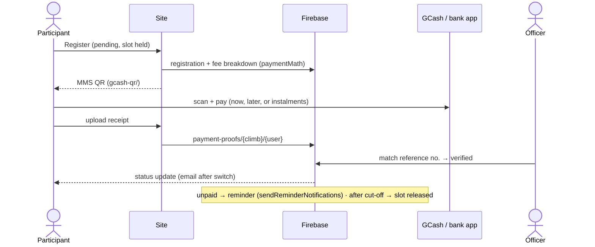

# Solution plan

How we deliver the MMS site and what it must do. Why: [ADRs](../adr/). What it is / how to run: [guides](../guides/).

**Contents:** [Goal](#goal) · [Open items](#open-items) · [Leads input](#leads-input-2026-11-05) · [Features](#features) · [Architecture](#architecture) · [Open Climbs migration](#open-climbs-migration) · [Gaps](#gaps-ui-vs-backend) · [Plan review](#plan-review-2026-11-09) · [Payments](#payments) · [Media](#media) · [Hosting & billing](#hosting--billing) · [Quality harness](#quality-harness) · [Content needed](#content-needed-from-mms) · [Recommendations](#recommendations--enhancements) · [Risks](#risks--challenges)

## Goal

Replace metropolitanms.org (Google Sites) with a site MMS runs itself, **₱54–₱100/month hard cap** ([ADR 0001](../adr/0001-HOSTING.md)): public info pages (live), Open Climbs registration + payments + tracking (officers stop chasing balances), member accounts, officer admin.

## Open items

Single tracker. Claude reads this before every commit and updates it in the same change.

**Board:** [MMS Official project](https://github.com/users/Oweeboi011/projects/2). Every item here, leads ask (L#), feature, recommendation (R#), risk, content row, plan-review action, parity todo and ADR is an issue on it (labels: `epic`, `phase:N`, `owner:*`, `requirement`, `recommendation`, `risk`, `content`, `parity`, `decision`, `plan-review`). Every issue sits under its phase issue (Phase 0 foundation … Phase 7 switch); none unparented. Issues assigned to someone else are theirs: hands off. New or changed row → same change updates its issue (close when done).

| # | Item | Owner | Blocks |
|---|------|-------|--------|
| 1 | [#28](https://github.com/Oweeboi011/MMS-Official-Site/issues/28) MMS Google Cloud billing account; move `mms-official-site-513809` to it, recreate budget there. Interim (2026-11-06): on Owee's "Owee Billing Main" with budget `mms-official-site hard stop` (US$1.70, this project only → `billing-budget`). MMS Gmail owner invite pending; once a member, switch Auth Google support email to it | MMS Gmail owner, Owee | Open Climbs phase 1 |
| 2 | [#29](https://github.com/Oweeboi011/MMS-Official-Site/issues/29) ~~Grant **Project Billing Manager** to `729371585953-compute@developer.gserviceaccount.com` (hard stop can't unlink billing without it)~~ (done 2026-11-06) | Owee | — |
| 3 | [#30](https://github.com/Oweeboi011/MMS-Official-Site/issues/30) ~~Merge PR #2, release v1.0.0~~ (done 2026-11-05) | Owee | — |
| 4 | [#31](https://github.com/Oweeboi011/MMS-Official-Site/issues/31) Accept Namecheap push (MMS account), auto-renew on (expires 2027-01-05); add Owee as Cloudflare Super Administrator | MMS Gmail owner | Domain safety |
| 5 | [#32](https://github.com/Oweeboi011/MMS-Official-Site/issues/32) Cloudflare API token (Pages:Edit) + account id → repo secrets for `continuous-delivery.yml` | MMS Cloudflare owner | Quality Gates deploy (local deploy works) |
| 6 | [#33](https://github.com/Oweeboi011/MMS-Official-Site/issues/33) Firebase console/CLI reachable from company laptops | Owee | Phase 1 |
| 7 | [#34](https://github.com/Oweeboi011/MMS-Official-Site/issues/34) Old project's password hash parameters (private, never in repo/chat). | Owee | Phase 2 |
| 8 | [#35](https://github.com/Oweeboi011/MMS-Official-Site/issues/35) Brevo account owned by MMS; SPF/DKIM for `metropolitanms.org` | MMS | Phase 4 |
| 9 | [#36](https://github.com/Oweeboi011/MMS-Official-Site/issues/36) ~~`npm audit` moderates (minimatch via eslint, undici via wrangler)~~ (done 2026-11-09: `overrides.minimatch ^11.0.1`, audit 0 site + backend; drop the override once eslint ships minimatch 11) | dev | — |
| 10 | [#37](https://github.com/Oweeboi011/MMS-Official-Site/issues/37) Open Climbs feature parity: 39 `it.todo` (manifest + axe done 2026-11-09) in `tests/parity/open-climbs.test.ts` (16 added by the [plan review](#plan-review-2026-11-09)) | dev | Switch |
| 11 | [#38](https://github.com/Oweeboi011/MMS-Official-Site/issues/38) Content from MMS ([below](#content-needed-from-mms)); then set `previewNotice = ''` | officers | Remove preview banner |
| 12 | [#39](https://github.com/Oweeboi011/MMS-Official-Site/issues/39) ~~SDLC setup~~ (done 2026-11-05): `development` default branch; `development` + `main` protected (PR, Quality Gates required, no force push, admins included); `production` environment needs Owee approval, protected branches only | Owee | — |
| 13 | [#40](https://github.com/Oweeboi011/MMS-Official-Site/issues/40) Leads: who is TCOM + notification recipients (by role); official FB page URL; is Viber a must (likely paid)? | leads | L2 |
| 14 | [#41](https://github.com/Oweeboi011/MMS-Official-Site/issues/41) Leads: real active-member count + recent climb photos with consent; ITI + expected expenses per upcoming climb; who approves reviews | leads, climb officers | L4, L5, L6 |
| 15 | [#42](https://github.com/Oweeboi011/MMS-Official-Site/issues/42) Officers confirm glossary wording (`src/frontend/data/glossary.ts`) and the new hero line | officers | — |
| 16 | [#43](https://github.com/Oweeboi011/MMS-Official-Site/issues/43) MMS Google Forms (MMS Gmail) for all surveys incl. joiner experience; replace `formUrl: '#'` in `content.ts` | officers | L6, L7 |
| 17 | [#44](https://github.com/Oweeboi011/MMS-Official-Site/issues/44) Officers confirm climb-finder rules + tips (`climbFinder` in `content.ts`) and rate climbs marked "Not yet rated" | climbs committee | L7 |
| 18 | [#45](https://github.com/Oweeboi011/MMS-Official-Site/issues/45) Ported Open Climbs functions over complexity limits (warn-only override in `eslint.config.js`): refactor `reminders`, `registrations`, `climbs`, `users`, `promoteFromWaitlist` when touched. Replace `ogPrerender` (social cards; needed for climb share previews, [#185](https://github.com/Oweeboi011/MMS-Official-Site/issues/185)) + `cspReport` with Cloudflare equivalents | dev | Phase 3 |
| 19 | [#46](https://github.com/Oweeboi011/MMS-Official-Site/issues/46) ~~Phase 1 finish~~ (done 2026-11-08): Google sign-in on (support email Owee's Gmail for now, item 1). Brevo secrets are placeholders until Phase 4 (item 8); `GITHUB_TOKEN` is a fine-grained PAT: renew before its GitHub expiry | Owee | — |
| 20 | [#47](https://github.com/Oweeboi011/MMS-Official-Site/issues/47) Apply `storage-lifecycle.json` + `cors.json` to the bucket (`gcloud storage buckets update gs://mms-official-site-513809.firebasestorage.app --lifecycle-file=… --cors-file=…`; gcloud blocked on company network). Officers pick retention: file says 730 days, [SECURITY](../guides/SECURITY.md#privacy-ra-10173) says medical certs + receipts 90 days after the climb | Owee, officers | Phase 3 (uploads) |
| 21 | [#48](https://github.com/Oweeboi011/MMS-Official-Site/issues/48) ~~Firebase web app + hardening~~ (done 2026-11-09). Web app `1:729371585953:web:3bc72ba88bd5b127fd2fe0`; `services/` (Firebase lazy-loaded on `/account/*` + `/admin`, sign-in email + Google, CRUD); repo **Variables** `VITE_FIREBASE_*` + `VITE_APP_CHECK_SITE_KEY` set (CD builds get them); preview host authorized for sign-in; web API key restricted to the site's referrers ([DEPLOYMENT](../guides/DEPLOYMENT.md#firebase-web-key--app-check); Firestore ignores key restrictions, rules guard it); **App Check** registered (reCAPTCHA Enterprise / Fraud Defense, token 1 day), **monitor mode only**: enforcement per service later (R7). Owner accepted Enterprise pricing 2026-11-09 (free 10k checks/month, then a US$8 tier that would trip the hard stop; see risks) | dev, Owee | — |
| 22 | [#49](https://github.com/Oweeboi011/MMS-Official-Site/issues/49) ~~Site data in Firestore~~ (done 2026-11-09, PR #186). **Decided 2026-11-08: all site data in Firestore.** Built: `announcements` (drafts hidden), `officers`, `surveys`, `siteSettings` (contact, socials, notices), `siteStats` (daily `refreshSiteStats`); rules + emulator tests, index; deployed 2026-11-09. **Public pages read them (2026-11-09):** Firestore REST, no SDK on first load (`services/publicData.ts`, `useSiteData.ts`): announcements, surveys, Execom on Our story, all officers + past terms on Leadership, settings in nav banner, footer, join, gallery. Empty collection or no `siteSettings/site` → `content.ts` sample stays; once `siteSettings/site` exists its blanks stay blank; live officers never mix with sample names. Follow-ups tracked elsewhere: officers enter confirmed content in `/admin` (item 11; no bulk seed of sample data); `siteStats` on home waits on the "active members" definition (item 14, L4); search index stays static ([plan review](#data)) | dev | Phase 3 |
| 23 | [#50](https://github.com/Oweeboi011/MMS-Official-Site/issues/50) MMS-owned GCash / bank receiving account + its QR (not a personal wallet); who verifies receipts per climb ([ADR 0007](../adr/0007-PAYMENTS-MANUAL.md)) | treasurer, officers | Phase 5 |
| 24 | [#51](https://github.com/Oweeboi011/MMS-Official-Site/issues/51) Site data collections ([audit](#gaps-ui-vs-backend)): `inquiries`, `reviews`, `faqs`, `glossary`, `media`, plus leadership (`officers` by body + past terms, `committees`, owner ask 2026-11-09) rules + tests built, deployed 2026-11-09. Left: seed, UI (item 21), inquiry notification (item 13). Page bodies + mountains stay in code unless officers need to edit them | dev | Phase 3–6 |
| 25 | [#52](https://github.com/Oweeboi011/MMS-Official-Site/issues/52) Release-note drafts: this repo's commit subjects have no `type:` prefix, so docs/tooling commits land in "Improvements". Pick: conventional prefixes here, or filter by changed paths (`src/frontend`) | dev, Owee | Phase 6 |
| 26 | [#53](https://github.com/Oweeboi011/MMS-Official-Site/issues/53) **URL plan** before phase 3: ADR 0005 says `/open-climbs/*`, but `/open-climbs` already 301s to the info page `/activities/open-climbs` (`legacyRedirects`). Pick app routes (proposal: `/climbs/:id`, `/register/:id`, `/account/*`, `/admin/*`) + old-app redirects (`mms-open-climbs.web.app/event/:id` → new) at the switch | dev, Owee | Phase 3 |
| 27 | [#54](https://github.com/Oweeboi011/MMS-Official-Site/issues/54) **Environments:** local + CI = emulators only; preview site = prod Firebase with writes off (`VITE_WRITES_ENABLED=false`) until the switch; never test data in prod. Document in DEPLOYMENT | dev | Phase 3 |
| 28 | [#55](https://github.com/Oweeboi011/MMS-Official-Site/issues/55) **Backups** before real data (phase 2): Firestore scheduled backups or weekly export to a bucket; check cost against the cap first; restore drill once | Owee | Phase 2 |
| 29 | [#56](https://github.com/Oweeboi011/MMS-Official-Site/issues/56) ~~**Bundle budget vs Firebase SDK**~~ (done 2026-11-09: Firebase lazy-loaded on `/account`, `/admin`; budgets initialJs 120 / lazyJs 150 KB gz) | dev | — |
| 30 | [#57](https://github.com/Oweeboi011/MMS-Official-Site/issues/57) **CSP header** (`public/_headers`) before Firebase: allow Firebase/Google APIs (incl. `firestore.googleapis.com` for public reads), Open-Meteo, trail embeds, YouTube/Wikimedia; report-only first (replaces `cspReport`, item 18) | dev | Phase 3 |
| 31 | [#58](https://github.com/Oweeboi011/MMS-Official-Site/issues/58) **Climb officer role:** ARCHITECTURE promises officers see only their climbs; ported rules are admin-only (old model). Keep admin-only, or add per-climb officer access (`climbInternal.officerEmails`) in rules + tests | officers, dev | Phase 6 |
| 32 | [#59](https://github.com/Oweeboi011/MMS-Official-Site/issues/59) **Privacy (RA 10173):** `/privacy` + `/help` pages (old app has both), consent text on registration + inquiry, retention per collection (inquiries, medical certs, receipts, `pageViews`, `failedRequests`, `auditLog`), data-export on request, DPO named | officers, dev | Phase 4 |
| 33 | [#60](https://github.com/Oweeboi011/MMS-Official-Site/issues/60) **Firestore free tier guard:** quota applies to the project's first database only ([Firebase pricing](https://firebase.google.com/docs/firestore/pricing)); `openclimbs` is the only one. Never delete it or add a second database | Owee | — |
| 34 | [#61](https://github.com/Oweeboi011/MMS-Official-Site/issues/61) **Admin scripts** not ported: first-admin bootstrap (`set-admin`), `grant-email-members` (the `users` rule comment points to it; path missing here), `purge-admin-pageviews`, emulator seed. Backfills (`backfill-climb-denorm`, `backfill-member-details`) only if synced data still needs them. Old `set-admin` uses the CLI token + REST: rewrite for `mms-official-site-513809`, never commit uids | dev | Phase 2 |
| 35 | [#62](https://github.com/Oweeboi011/MMS-Official-Site/issues/62) **Climb history per member** (owner ask 2026-11-09, planned): `refreshSiteStats` also writes private `memberStats/{uid}` (`climbCount`, `climbs` newest first, `lastClimbAt`; member + admins read, function-only write) from confirmed, non-no-show registrations on finished climbs; admin list sorted by climb count; member sees own log (replaces sample `passportStats`). Old-app history arrives with the sync (phase 2); pre-app climbs only if officers supply records | dev | Phase 4 |

## Leads input (2026-11-05)

| # | Ask | Plan | Status |
|---|-----|------|--------|
| L1 | [#19](https://github.com/Oweeboi011/MMS-Official-Site/issues/19) Reuse Open Climbs capabilities | [migration](#open-climbs-migration); parity todos in `tests/parity` | planned |
| L2 | [#20](https://github.com/Oweeboi011/MMS-Official-Site/issues/20) Membership inquiry / climb joiner form; notify TCOM + ExeCom; Viber/text; or FB page chat | membership: MMS Google Form → email TCOM + ExeCom (₱0) · climb joiners: link to Open Climbs registration (no 2nd list) · "Message us" → FB Messenger link (₱0) · Viber/SMS out (paid, cost cap) | waiting on open item 13 |
| L3 | [#21](https://github.com/Oweeboi011/MMS-Official-Site/issues/21) Friendlier opener ("new hobby? join our hikes") | hero: "Your first summit starts here." + join copy (owner pick 2026-11-09, replaced "Looking for a new hobby?") | **done**, wording to confirm (item 15) |
| L4 | [#22](https://github.com/Oweeboi011/MMS-Official-Site/issues/22) Active members + recent climb photos on home | stats + photo strip on home, real data only | waiting on item 14 |
| L5 | [#23](https://github.com/Oweeboi011/MMS-Official-Site/issues/23) Join a climb → details (ITI, expected expenses) → join per climb | per-climb detail page; Join → that climb on Open Climbs; later native ([phases 3, 5](#open-climbs-migration)) | waiting on item 14 |
| L6 | [#24](https://github.com/Oweeboi011/MMS-Official-Site/issues/24) Review/feedback for past climbs, moderated | Google Form → officers approve → quotes block; later in-app rating | waiting on item 14 |
| L7 | [#25](https://github.com/Oweeboi011/MMS-Official-Site/issues/25) Joiner experience survey; recommend a climb to first-timers | "Joiner experience survey" on `/surveys` ("Form coming soon" until a real link); climb finder on `/activities/open-climbs`: rules by difficulty in `content.ts` (`climbFinder`) | built; waits on items 16, 17 |
| L8 | [#26](https://github.com/Oweeboi011/MMS-Official-Site/issues/26) Define BMCM, AMC, LNT, SART | tooltips (`GlossaryText`) + `/about/glossary` | **done**, wording to confirm (item 15) |
| L9 | [#27](https://github.com/Oweeboi011/MMS-Official-Site/issues/27) Not one long page on phone; summary home or search | each section has its own page (`/about` …); home shows 3 cards + "See all"; in-browser search `/search?q=` (`lib/search.ts`, `data/searchIndex.ts`), Search link in nav | **done** |

## Features

P1 = launch · P2 = soon after · P3 = later. Open Climbs parity list: `tests/parity/open-climbs.test.ts`.

| Who | Feature | P |
|-----|---------|---|
| Guest | Public pages | done |
| Guest | Climb schedule from DB (fees, trail class, slots left) | 1 |
| Guest | Register: contact, emergency contact, waiver, medical cert (major). Needs a free site account (Google / email), **not MMS membership**; guest fee via `memberType: joiner` (owner decision 2026-11-09) | 1 |
| Guest | Pay by GCash / QR Ph transfer, upload receipt, officer verifies; confirmation email | 1 |
| Guest | **Completed + past climbs** ([#191](https://github.com/Oweeboi011/MMS-Official-Site/issues/191), owner ask 2026-11-09): Open Climbs shows this year's upcoming and completed climbs; every past year recorded in `climbs` and browsable by year (old app via sync; pre-app climbs entered by admins from officer records) | 1 |
| Guest | **Share a climb** ([#185](https://github.com/Oweeboi011/MMS-Official-Site/issues/185), owner ask 2026-11-09): Facebook (sharer link), Messenger (phone share sheet; desktop needs an MMS Facebook App ID), Instagram story (generated 1080×1920 story image via the phone share sheet; no web link opens Stories). Link previews need per-climb Open Graph tags (item 18) | 1 |
| Guest / member | Sign in (Google / email; no SMS) · my registrations + receipts | 1 |
| Member | Profile (batch, tribe) · climb log / passport | 2–3 |
| Climb officer | Climbs CRUD · participants paid/pending/unpaid · verify receipts · LGU CSV | 1 |
| Climb officer | Post-climb expense report | 2 |
| Admin | Announcements · roles | 1 |
| Admin | In-app content editing · treasurer summary | 2 |

Out of scope: store, mobile app, chat.

**Before payments go live:** MMS receiving account + QR (item 23) · privacy notice + refund policy approved · security rules tested · end-to-end test climb with real ₱20 payments.

## Architecture

As built + target: [ARCHITECTURE](../guides/ARCHITECTURE.md) (system, layers, roles). Data: [DATA](../guides/DATA.md). Security/privacy: [SECURITY](../guides/SECURITY.md).

## Open Climbs migration

Every feature of [mms-open-climbs](https://github.com/Oweeboi011/mms-open-climbs) at `www.metropolitanms.org/open-climbs/*`, on new Firebase project `mms-official-site-513809` (owners: MMS Gmail primary + Owee). Same users, nobody re-registers. No shared resources; old site stays until retired (2027). Why: [ADR 0005](../adr/0005-OPEN-CLIMBS-FIREBASE.md).

| Layer | Old `mms-open-climbs` | New |
|---|---|---|
| Frontend | JSX SPA, Firebase Hosting | this repo (TSX), Cloudflare Pages |
| Accounts | Firebase Auth | new Auth; users copied **with password hashes** |
| Data / files | Firestore `openclimbs`, Storage | same shapes; **one-way sync old → new** |
| Rules, indexes, functions | old repo | copied to `src/backend` |

**Sync (until switch):** scheduled function in the new project every 15 min; read-only service account on old project (Secret Manager). Users `listUsers` → `importUsers` (scrypt params); Firestore upsert where `updatedAt` > last sync, deletes mirrored, logs not synced; Storage copied by path. New site writes **off** (`VITE_WRITES_ENABLED=false`) and email triggers off — no double emails.

**Switch (owner picks date):** old site read-only + final sync + stop sync → enable writes + emails, `APP_URL` = www → officers use new admin; 2027: old site 301 + repo archived.

| # | Phase | Done when |
|---|---|---|
| 0 | Decide (ADR 0005 accepted 2026-11-05) | laptop check (open item 6) |
| 1 | Project: hard stop (interim Owee billing, open item 1), Auth (email + Google, domain www), Firestore asia-southeast1 + Storage us-east1 (no-cost bucket), rules/indexes/functions here (emails off). Live 2026-11-08: DB `openclimbs`, Firestore + Storage rules, indexes, Auth email/password + Google, domain www, all 21 functions (emails off). **Done**; billing move still open (item 1) | rules + functions tests pass on emulator; functions deployed |
| 2 | Sync: first full copy | counts match; an existing user signs in |
| 3 | Public read: schedule, event page | matches old site |
| 4 | Accounts: log in, reset, My Details, My Registrations, notifications | existing users see their data |
| 5 | Register: form, waitlist, fees, waiver, GCash proof, docs, pledge, feedback | e2e on emulator |
| 6 | Admin: dashboard, climbs, detail/day sheet, registrations, payments, expenses, donations, users, analytics, insights, release notes | parity todos = 0 |
| 7 | Switch | one real climb run on new site |

Port rules: port, don't redesign (same Firestore shapes) · JSX → TSX per file · tests move with code · old docs: copy what applies, delete rest.

## Gaps: UI vs backend

Checked 2026-11-08; updated 2026-11-09: public pages read site content (item 22), collections still empty so sample content shows.

| Shown in UI | Source today | Backend | Plan |
|---|---|---|---|
| Open climbs list | `openClimbs` in `content.ts` | `climbs` (empty until sync) | phase 3: read `climbs` |
| Announcements / news | `announcements` | new `announcements` | **reads Firestore**, sample fallback (item 22) |
| Officers, contact person, socials, preview notice | `officers`, `contactName`, `contactPhone`, `socials`, `previewNotice` | new `officers`, `siteSettings` | **reads Firestore**, sample fallback (item 22) |
| Member stats (home, passport) | `stats`, `passportStats` | new `siteStats`, computed from `users`, `registrations` | UI waits on item 14 (which number is "active members"); passport = per member, item 35 |
| Surveys, membership inquiry (L2) | Google Form links | new `surveys` (links only), **read by `/surveys`** | answers stay in Google Forms (₱0) |
| Climb reviews (L6) | not built | `feedback` (ratings), no approval flow | phase 5 + approval field |
| Mountains, glossary, climb finder, search | static data | not needed | stay static |

**Data audit (2026-11-09).** Old-app parity complete: all 14 Firestore collections the old app uses (`users`, `climbs`, `climbPrivate`, `climbInternal`, `climbExpenses`, `registrations`, `memberDetails`, `notifications`, `feedback`, `pageViews`, `failedRequests`, `auditLog`, `releaseNotes`, `releaseNoteEmailJobs`) and all Storage paths have rules here. Donations live on `climbs.donationDrive` + registrations, refunds on registrations (no own collection). Site data added for this site (open item 24, rules + emulator tests built 2026-11-09):

| Data | Today | Collection |
|---|---|---|
| Membership inquiries (L2) | Google Form | `inquiries`: guest create (bounded; App Check, item 21), admin read. Notify TCOM + ExeCom once recipients known (item 13) and emails on |
| Approved climb reviews (L6) | not built; `feedback` is immutable, private | `reviews`: admin publishes a quote from `feedback` (name consent), public read |
| FAQs, glossary, videos, gallery, join steps | static `content.ts`, `glossary.ts` | `faqs`, `glossary`, `media` |
| Page bodies (`subpages.ts`, `pages.ts`), mountains (`topMountains.ts`), climb-finder rules | static, generated or structured | keep in code (reviewed, versioned, large); revisit with admin editor |
| Survey answers | Google Forms | stay in Forms (₱0, officers own them) |

Backend with no UI yet: `users`, `memberDetails`, `registrations`, `climbPrivate`, `climbInternal`, `climbExpenses`, `notifications`, `releaseNotes`, `feedback`, `pageViews`, `failedRequests`, `auditLog` → phases 3–6 (parity todos in `tests/parity`).

Missing functions: sync old → new (phase 2, item 7) · `ogPrerender`, `cspReport` replacements on Cloudflare (item 18). Missing services: Firebase web app + App Check (item 21) · Brevo (item 8) · MMS receiving account (item 23). No payment gateway ([ADR 0007](../adr/0007-PAYMENTS-MANUAL.md)).

## Plan review (2026-11-09)

Full pass over architecture, API, data and Open Climbs feature parity. New open items 26–34; parity todos added to `tests/parity/open-climbs.test.ts`.

### Architecture

| Area | Finding | Action |
|---|---|---|
| Routing | app URLs undecided; `/open-climbs` already redirects to an info page | item 26 |
| Environments | one Firebase project; preview + local would hit prod | item 27 |
| Backups / DR | no Firestore backup; hard stop runbook exists | item 28 |
| Bundle | Firebase SDK exceeds the 120 KB budget unless lazy-loaded | item 29 |
| Security headers | no CSP yet | item 30 |
| Roles | climb-officer scoping promised, not in rules | item 31 |
| Backend delivery | rules + functions deployed by hand; no CD | keep manual until item 5; then CD job with keyless Workload Identity (₱0) |
| Monitoring | errors only in Cloud Logging; no alert | R8 uptime + free log-based email alert on function errors |
| Regions | Firestore + Functions `asia-southeast1`, Storage `us-east1` | accepted (cost); see risks |
| Static fallback | R5c needs a build-time snapshot of public collections | design with item 21 |

### API

| Area | Finding | Action |
|---|---|---|
| Contracts | callables have no documented inputs/outputs/errors | document per callable in API.md as each UI lands |
| Abuse | callables + public `inquiries` lack App Check | App Check monitoring since item 21; `enforceAppCheck` on callables as their UI lands (R7) |
| Email | Brevo free tier is daily-capped; reminders + announcements batch through `batchSend` | check volume vs cap before emails on (item 8) |
| External | Open-Meteo (weather, free, no key), AllTrails/Komoot/Google Maps embeds, PAGASA/Windy links used by old event page | allow in CSP (item 30); no keys needed |
| Release notes | checkpoint per repo (`sourceRepo`, contract in [API](../guides/API.md)); commit-type noise | item 25 |

### Data

| Area | Finding | Action |
|---|---|---|
| Free tier | only the first database gets free quota | item 33 |
| Shapes | functions are JS, frontend TS; list items in `siteSettings` can't be checked by rules | shared types + runtime validation in the services layer (item 21) |
| Search | `searchIndex` is static; Firestore content (climbs, announcements) won't be searchable | merge Firestore results at runtime, or index at build, with item 21 |
| Retention | lifecycle file 730 d vs policy 90 d; no retention for inquiries/logs | items 20, 32 |
| Seed | sample `content.ts` is not official: seed only officer-confirmed content (item 11); sample stays as fallback | items 11, 22 |

### Open Climbs features not yet tracked

Compared the old app's routes and pages with the parity todos; these were missing and are now `it.todo`: weather forecast per climb (Open-Meteo) + PAGASA/Windy links · trail map embeds (AllTrails/Komoot/Maps) · packing list + LNT ethics · registrant-only section (participants, resources, pre-climb meetings, officer contacts) behind sign-in · admin audit log · help + privacy pages · installable app (PWA manifest, icons) · accessibility tests (old app has `tests/accessibility`) · verify-email banner · edit registration · receipt viewer · beginner guide + registration/cancellation policy · admin climb setup checklist · in-browser image compression (keeps Storage small) · member + admin help guides (old `USER_MANUAL.md`) · lightweight markdown for notes. Admin scripts: item 34. Swept: all old routes, pages, components, utils, hooks, contexts, data and scripts.

## Payments

Goal: every fee collected **before the climb**, no officer advancing money. No gateway, ₱0 per payment: [ADR 0007](../adr/0007-PAYMENTS-MANUAL.md) (supersedes PayMongo, ADR 0002).

- Climb page shows full fee breakdown + convenience fee before payment. Guide/porter fees paid after climb from collected funds.
- Refunds (officers to approve): MMS cancels → full refund/credit · participant cancels ≥ 7 days before → minus costs paid · no-show → none.
- Receiving account: MMS-owned GCash / bank (item 23). Officers match receipt reference numbers against the account statement.

Costs: [BILLING](../guides/BILLING.md#payments).

## Media

Why: [ADR 0004](../adr/0004-MEDIA.md).

| Media | Where | Shown as |
|-------|-------|----------|
| Site photos | `public/images/`, WebP, ≤ 1.2 MB each, ≤ 15 MB total (`check:images`) | `` |
| Videos | YouTube / MMS Facebook | embed |
| Climb albums | **MMS-owned** Drive folder, subfolder per climb | link only (`href` in `subpages.ts` `/media/photos`, `photoAlbumsUrl` in `content.ts`) |

Never embed Drive files as ``/`<video>` (not a CDN). Link **folders**, not files (enforced by `tests/unit/data.test.ts`).

Add album: upload to `Albums/YYYY-MM climb` → remove opted-out people → share "anyone with link, Viewer" → card `href` + `linkLabel 'View album'` → check → deploy.

Risks: owner leaves → MMS-owned folder, ≥ 2 managers · inactive 2 yrs → sign in yearly · 15 GB full → resize ≤ 2048 px · privacy → photo-consent clause + takedown window (**needs officer approval**) · link rot → yearly link check · repo bloat → image budget.

## Hosting & billing

Costs, accounts, Firebase hard stop, per-payment fees: [BILLING](../guides/BILLING.md).

## Quality harness

Gates, tests, hooks, Quality Gates: [CODE-QUALITY](../guides/CODE-QUALITY.md). Why: [ADR 0003](../adr/0003-QUALITY-HARNESS.md).

## Content needed from MMS

**Data loading: Ken** (owner decision 2026-11-09): officers current + past ([#193](https://github.com/Oweeboi011/MMS-Official-Site/issues/193)), past open climbs all years ([#194](https://github.com/Oweeboi011/MMS-Official-Site/issues/194)), past members ([#195](https://github.com/Oweeboi011/MMS-Official-Site/issues/195); roster model to decide first, RA 10173). Dev builds the tooling (climbs editor/import, members roster); Ken's issues are his.

| Item | Page |
|------|------|
| Current officers (**waiting**) · committees | About |
| Official email, social links | Footer, Join |
| Membership requirements, dues, BMC fee | Join, BMCM |
| Upcoming open climbs + fees | Activities |
| MMS photos/videos (replace Wikimedia) | Media, home |
| Member stats · history after 2003 | Members, History |
| Trail-class review (Top 100) · past-officer spellings | Mountains, Leadership |
| **Past officers from way back** (Execom, TComm, BOT): name, role, term per year; entered in `/admin` → Leadership (`current` off) | Leadership |
| Refund policy · privacy notice | Registration |

## Recommendations & enhancements

Ordered by value for cost. All within the cost cap unless marked.

| # | Recommendation | Why | When |
|---|---|---|---|
| R1 | Services layer + auth state first (item 21), behind `VITE_WRITES_ENABLED=false` | every later phase needs it; read-only keeps sync safe | phase 3 |
| R2 | Read climbs from Firestore; keep a static fallback if Firestore fails | one source of truth; site stays up | phase 3 |
| R3 | Firestore `onSnapshot` only on officer screens; public pages use one-time reads + cache | stays in free read quota | phase 3+ |
| R4 | Admin screens for announcements, officers, site settings (item 22) | ends "send it to Owee" bottleneck | phase 6 |
| R5 | `siteStats` refreshed by a scheduled function into one doc | 1 read per visit instead of counting | phase 3 |
| R5b | Receipt check helper: officer view lists unverified proofs with amount + reference no. side by side | manual verification is the main payment cost | phase 6 |
| R5c | Static fallback for public pages (last good `content` snapshot) if Firestore is down or hard stop fires | site stays readable | phase 3 |
| R6 | Apply Storage lifecycle + CORS; retention set by officers (item 20) | privacy (RA 10173), storage cost | before uploads |
| R7 | App Check **enforcement** on callables, Storage, then Firestore (registered + monitoring since 2026-11-09, item 21; Firestore needs public REST reads to send a token first) | blocks scripted abuse that could trip the hard stop | phase 3 |
| R8 | Uptime check (free: Cloudflare health check or GitHub Actions cron hitting www + one callable) | hard stop or expiry is silent today | soon |
| R9 | Dependabot / Renovate (free) for both `package.json`s | ports pin exact versions; audit only catches high+ | soon |
| R10 | Refactor the complex ported functions when touched (item 18) | warn-only override hides real complexity | ongoing |
| R11 | Climb log / passport from real registrations | member value (Features P2–3) | after switch |
| R12 | PWA offline climb-day sheet for officers | trailheads have no signal | after switch |
| R13 | Tagalog copy for key pages | reach | officers decide |

Not recommended: payment gateway for now (fees + KYC; revisit per ADR 0007) · SMS / Viber notifications (paid, cost cap) · native app (out of scope) · a CMS service (paid or another account to own).

## Risks & challenges

| Risk | Impact | Likelihood | Mitigation |
|---|---|---|---|
| Single maintainer (Owee): accounts, deploys, secrets | site stalls if unavailable | high | 2-owner rule on every account; docs + runbooks here; MMS Gmail owner on Firebase (item 1) |
| Billing on Owee's account (item 1) | personal liability on a personal card | high until moved | move to MMS billing account; budget + hard stop wired |
| Hard stop fires (abuse, bug, loop) | all Firebase features down until relinked | low | App Check (R7), max 5 instances, uptime check (R8); relink steps in [API](../guides/API.md) |
| Password-hash migration fails | users can't sign in, must reset | medium | test with one account in phase 2; fallback = password reset email |
| Two systems during sync (old + new) | double emails, writes lost on new site | medium | emails + writes off until switch; one-way sync; switch checklist |
| Storage in `us-east1`, Firestore in `asia-southeast1` | slower uploads/downloads for PH users; cross-region egress | certain, small | files are small; free tier; region fixed once created |
| Retention mismatch (730 d file vs 90 d policy) | holds medical data longer than promised | high until fixed | item 20 before uploads open |
| Free tiers change (Firebase, Cloudflare, Brevo) | surprise cost | low | budget alerts + hard stop; BILLING re-checked yearly |
| reCAPTCHA Enterprise past 10k checks/month (bot floods sign-in) | US$8 tier > US$1.70 hard stop → Firebase down | low | only `/account/*` + `/admin` load it; token TTL 1 day; check Fraud Defense usage monthly; switch App Check to classic reCAPTCHA v3 (free 1M) if usage climbs |
| Company laptops block Firebase / Cloudflare consoles (item 6) | can't operate from work | medium | CLI works; personal device fallback |
| Network TLS interception breaks `gcloud` | can't apply bucket settings | certain on company network | console or another network (item 20) |
| CD prod deploy skipped without Cloudflare token (item 5) | merged code not live, silently | high until fixed | `npm run deploy:prod` after merge; add token |
| Content never confirmed by officers (items 11, 13–17) | preview banner stays; sample data public | medium | content list with owners; banner says "sample" |
| Domain expiry 2027-01-05, auto-renew off (item 4) | site goes dark | medium | accept Namecheap push, auto-renew on |
| Secrets typed into shells/chat | leak | medium (happened once, prefix only) | prompt-only secret entry; fine-grained, expiring tokens; rotate on doubt |
| Manual payment verification (no gateway) | slow confirmations; officer workload; fake receipts | medium | reference-no. check vs statement; R5b helper; refund policy approved first; revisit gateway if volume grows |
| Personal wallet used to receive payments | MMS money mixed with an officer's | medium until item 23 | MMS-owned account only |
| All site data in Firestore (item 22) | public pages depend on Firebase + hard stop | medium | static fallback (R5c); reads cached; free quota far above traffic |
| Privacy (RA 10173): medical certs, IDs | legal + trust | medium | private bucket, rules tests, retention, DPO, consent at registration |
