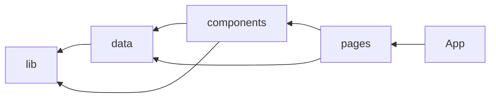
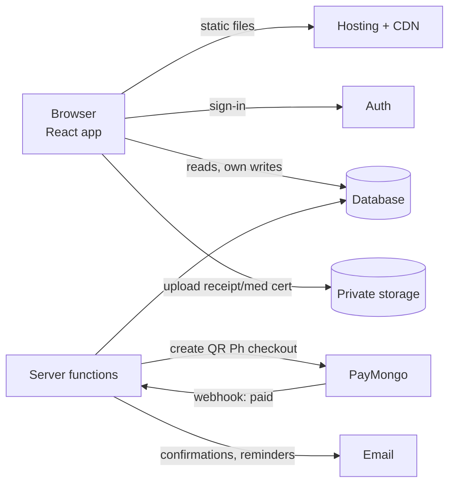

# Architecture

## Today

Static SPA. All content in `src/data/*.ts`. Layers (enforced by dependency-cruiser):

Inner layers never import outer ones. `data` has no React. `lib` is pure.

## Target (phase 2+)

Backend: new MMS Firebase project ([ADR 0005](../adr/0005-open-climbs-firebase.md), [migration plan](open-climbs-migration.md)). Shape:

Rule: the browser only talks to **our domain** and the phase 2 backend API endpoints. Payment keys live only in server functions.

## Data model

Firestore shapes follow the Open Climbs app: [DATA](https://github.com/Oweeboi011/mms-open-climbs/blob/main/docs/guides/DATA.md) (copied here at phase 1).

## Roles

| Role | Can |
|------|-----|
| Guest | Read public data, create own registration |
| Member | + own profile and registrations |
| Climb officer | + participants and payments **of their climbs**, verify receipts |
| Admin | Everything, assign roles |

Enforced server-side (database/storage rules), never only in the UI.

## Security & privacy (RA 10173, Data Privacy Act)

- Consent checkbox + privacy notice at registration: what, why (safety, LGU manifest), who sees it, how long.
- Collect the minimum. Auto-delete medical certs and receipts **90 days after the climb**. Keep payment records for accounting.
- Private storage bucket; view uploads through short-lived signed URLs.
- Assign a Data Protection Officer; check NPC registration. Breach → notify NPC + affected people within 72 h.
- All accounts (host, billing, PayMongo, domain, GitHub) owned by an **MMS account**, with ≥2 officer admins and 2-step verification. Hand over access at officer turnover.
- Nightly database export; code in GitHub.
