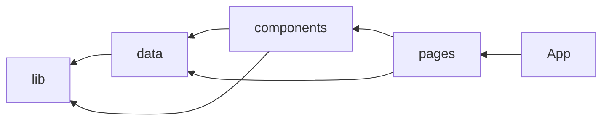
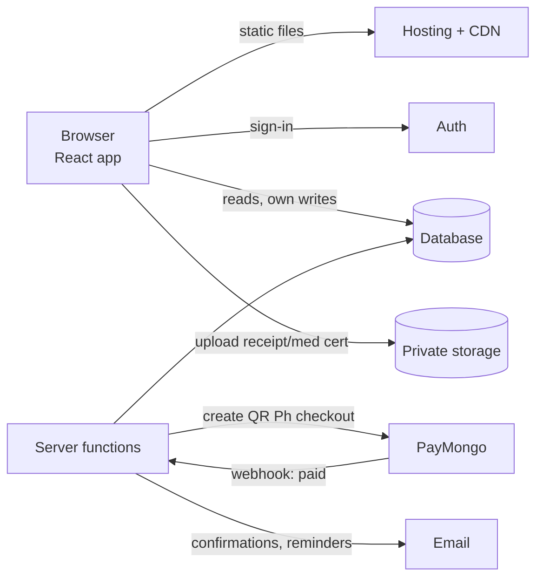

# Architecture

## Today

Static SPA. All content in `src/data/*.ts`. Layers (enforced by dependency-cruiser):

Inner layers never import outer ones. `data` has no React. `lib` is pure.

## Target (phase 2+)

Provider is open ([ADR 0001](../adr/0001-hosting.md)), but the shape is the same:

Rule: the browser only talks to **our domain** and the phase 2 backend API endpoints. Payment keys live only in server functions.

## Data model

| Collection | Key fields |
|------------|-----------|
| `climbs` | title, mountain, dates, type, trailClass, feeBreakdown[], slots, status, officerIds[] |
| `registrations` | climbId, user or guest contact, emergencyContact, waiverAccepted, medicalCertPath, status (pending/paid/cancelled), amountDue |
| `payments` | registrationId, method (qrph/manual/…), amount, gatewayFee, reference, receiptPath, verifiedBy, paidAt |
| `members` | name, email, bmcBatch, tribe, role, emergencyContact |
| `announcements` | date, category, title, body, published |

## Roles

| Role | Can |
|------|-----|
| Guest | Read public data, create own registration |
| Member | + own profile and registrations |
| Climb officer | + participants and payments **of their climbs**, verify receipts |
| Admin | Everything, assign roles |

Enforced server-side (database/storage rules), never only in the UI.

## Security & privacy (RA 10173, Data Privacy Act)

- Consent checkbox + privacy notice at registration: what, why (safety, LGU manifest), who sees it, how long.
- Collect the minimum. Auto-delete medical certs and receipts **90 days after the climb**. Keep payment records for accounting.
- Private storage bucket; view uploads through short-lived signed URLs.
- Assign a Data Protection Officer; check NPC registration. Breach → notify NPC + affected people within 72 h.
- All accounts (host, billing, PayMongo, domain, GitHub) owned by an **MMS account**, with ≥2 officer admins and 2-step verification. Hand over access at officer turnover.
- Nightly database export; code in GitHub.
