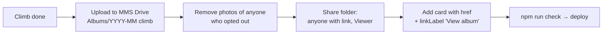

# Media: photos & videos

Why: [ADR 0004](../adr/0004-media.md).

| Media | Where | Shown on site as |
|-------|-------|------------------|
| Site photos (hero, cards, ~10 gallery shots) | `public/images/`, WebP, ≤ 1.2 MB each, ≤ 15 MB total (`npm run check:images`, part of `check`) | ``, served by Vercel |
| Videos | YouTube (public/unlisted) or MMS Facebook page | Embedded player |
| Full climb albums | **MMS-owned** Google Drive folder (one subfolder per climb) | Link only: `href` on album cards (`src/data/subpages.ts` `/media/photos`) + `photoAlbumsUrl` (`src/data/content.ts`) |

Never embed Drive files as ``/`<video>` — Drive isn't a CDN; direct links break, get throttled, and serve full-size originals.

## Adding an album

Link the **folder** (`https://drive.google.com/drive/folders/…`), not files — folder links survive adding/reordering photos. Enforced by `tests/unit/data.test.ts`.

`photoAlbumsUrl` = parent `Albums` folder; card `href` = one climb's subfolder.

## Long-run risks

| Risk | What happens | Mitigation |
|------|--------------|------------|
| Owner leaves / account deleted | Files they own vanish → dead links | Folder owned by an MMS account (Workspace for Nonprofits shared drive if approved, else one MMS Gmail), ≥ 2 officer managers. Never a personal account |
| Inactive account | Google deletes personal accounts inactive 2 years | Sign in to the MMS account at least yearly (treasurer/secretary handover checklist) |
| Storage full | Free Google account = 15 GB shared with Gmail/Photos; uploads stop | Upload resized (≤ 2048 px) not raw. Check quota yearly. Archive old years offline if needed |
| Privacy (RA 10173) | "Anyone with link" = public; links get forwarded | **Proposed, needs officer approval:** photo-consent clause in climb waiver; takedown-on-request window (e.g. 7 days). No IDs/medical forms in album folders |
| Link rot | Folder moved to trash or re-shared → 404 | Yearly link check: open every album `href`. Remove dead cards |
| Drive blocked on some networks | Company/school networks may block Drive | Site still works; only album links fail. Key photos stay in `public/images` |
| Google policy change | Free quota/sharing terms change | Albums are links only; swapping host = editing hrefs |
| Repo bloat | Images in git grow the repo forever | Image budget in `test:perf`; more photos → Drive album, not repo |
