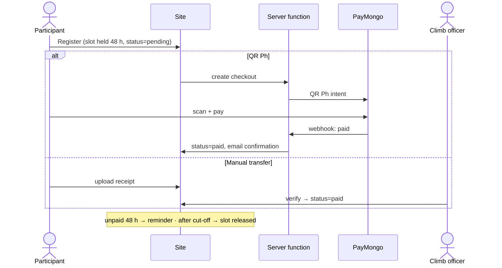

# Payments

Goal: every fee collected **before the climb**, visible at a glance, no officer advancing money. Rates: [hosting & billing](hosting-and-billing.md#per-payment-fees-outside-the-monthly-bill). Why QR Ph: [ADR 0002](../adr/0002-payments.md).

## Flow

## Rules

- Climb page shows the full fee breakdown (transport, LGU, guide/porter, environmental, excess baggage) **and** the convenience fee before payment.
- Guide/porter fees are paid after the climb from collected funds.
- Refunds (officers to approve):
  - Cancelled by MMS → full refund or credit.
  - Participant cancels ≥7 days before → refund minus costs already paid.
  - No-show → no refund.

## PayMongo setup

1. Register MMS as an organization (SEC documents for KYC).
2. Link the MMS bank account.
3. API keys go into server-function secrets only.
4. Point the webhook at the server function.
