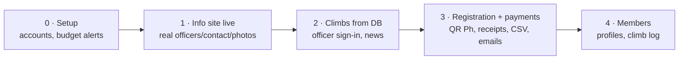

# Plan

## Goal

Replace metropolitanms.org (Google Sites) with a site MMS runs itself, for **₱500/month or less**:

- Public info pages (done in the prototype).
- Open climb registration + online payment + payment tracking, so officers stop chasing balances and advancing their own money.
- Member accounts and an officer admin area.

## Features

P1 = launch · P2 = soon after · P3 = later.

| Who | Feature | P |
|-----|---------|---|
| Guest | Browse public pages | done |
| Guest | Climb schedule from the database (fees, trail class, slots left) | 1 |
| Guest | Register for a climb: contact, emergency contact, waiver, medical cert (major) | 1 |
| Guest | Pay via QR Ph, or upload a transfer receipt; confirmation email with ITI + fee breakdown | 1 |
| Member | Sign in (Google / email link; no SMS) · my registrations + receipts | 1 |
| Member | Profile (batch, tribe) · climb log / passport | 2–3 |
| Climb officer | Create/edit climbs · participant list with paid/pending/unpaid · verify receipts · CSV for the LGU manifest · close registration | 1 |
| Climb officer | Post-climb expense report | 2 |
| Admin | Announcements · assign roles | 1 |
| Admin | Edit page content in-app · treasurer payment summary | 2 |

Out of scope: store, mobile app, chat.

## Roadmap

Phase 1 can go live alone. Hosting for phase 2+ is still open ([ADR 0001](../adr/0001-hosting.md)).

**Before payments go live:** PayMongo KYC approved · privacy notice + refund policy approved by officers · security rules tested · end-to-end test climb with real ₱20 payments.

## Content still needed from MMS

| Item | Page |
|------|------|
| Current officers (**waiting**) · committees + heads | About |
| Official email, Facebook/Instagram links | Footer, Join |
| Membership requirements, dues, BMC fee | Join, BMCM |
| Upcoming open climbs + fees | Activities |
| MMS photos/videos (replace Wikimedia) | Media, home |
| Member stats · history after 2003 | Members, History |
| Trail-class review of the Top 100 table · past-officer name spellings | Mountains, Leadership |
| Refund policy · privacy notice | Registration |
