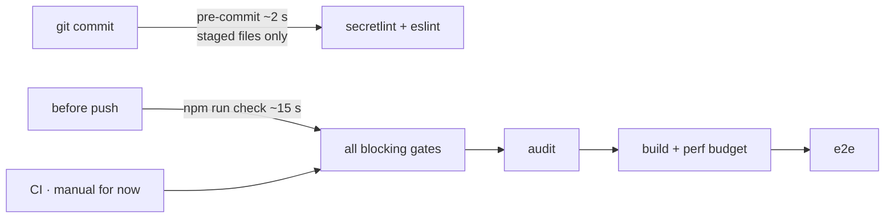

# Quality harness

**Minimum viable harness:** one command (`npm run check`, ~15 s) and one fast pre-commit hook. No step exists unless it catches something real. Why these tools: [ADR 0003](../adr/0003-quality-harness.md).

## Where each check runs

## Gates

| Priority | Concern | Tool | Config | Blocks? |
|----------|---------|------|--------|---------|
| High | Secrets | secretlint | `.secretlintrc.json` | ✅ |
| High | Bad patterns, dead logic (identical branches, unused collections, redundant conditions) | eslint + sonarjs | `eslint.config.js` | ✅ |
| High | Banned API / forbidden imports (`eval`, `innerHTML`, `dangerouslySetInnerHTML`, lodash/moment/axios) | eslint | `eslint.config.js` | ✅ |
| High | Cyclomatic (≤12) + cognitive (≤15) complexity | eslint | `eslint.config.js` | ✅ |
| High | Circular deps, layer violations (clean architecture), orphan files, dev deps in `src` | dependency-cruiser | `.dependency-cruiser.cjs` | ✅ |
| High | Dead code: unused files, exports, types, deps | knip | `knip.json` | ✅ |
| High | Code duplication (> 3%, ≥ 60 tokens) | jscpd | `.jscpd.json` | ✅ |
| High | Vulnerable packages (high+) | `npm audit` | — | ✅ in CI |
| High | Reusable components not used | review (`/code-review`) | — | review |
| High | SOLID / clean architecture | layers via dependency-cruiser + review | — | partly |
| Low | Lint style, `no-console` | eslint | — | warn |
| Low | Naming conventions | eslint `naming-convention` | — | warn |
| Low | Type checking | `tsc -b` (strict, no unused locals/params) | `tsconfig.json` | ✅ (cheap) |
| Low | Formatting | `.editorconfig` | — | editor only |

Generated data files (`src/data/credits.ts`, `src/data/topMountains.ts`) are excluded from lint and duplication checks.

## Tests

| Kind | Folder | Tool | Covers |
|------|--------|------|--------|
| Unit | `tests/unit` | vitest | sitemap integrity, data invariants, helpers |
| Component | `tests/component` | vitest + Testing Library | `ContentBlocks` (all block types, table paging) |
| Integration | `tests/integration` | vitest + Testing Library | every route renders, redirects, nav, page flows |
| E2E | `tests/e2e` | Playwright (Chromium) | smoke: home, deep link, paging on the real build |
| Performance | `tests/performance` | node script | gzipped bundle JS ≤ 120 KB, CSS ≤ 20 KB; `image-budget.mjs`: `public/images` ≤ 1.2 MB each, ≤ 15 MB total (in `check`) |

Add a test at the lowest level that can catch the bug. E2E stays a short smoke suite.

## Code review

Run `/code-review` in Claude Code on every change before merging. It covers what tools can't: SOLID, reuse of existing components, naming that reads well, simplification.

## Not included (on purpose)

- **Prettier:** would reformat 34 files. Revisit if formatting debates start.
- **Coverage thresholds:** they reward tests that count lines. Review tests in PRs instead.
- **Husky:** `simple-git-hooks` does the same with no runtime cost.
